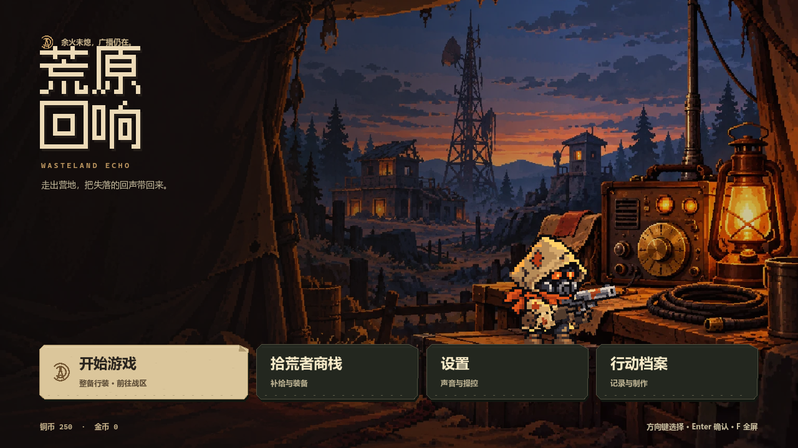
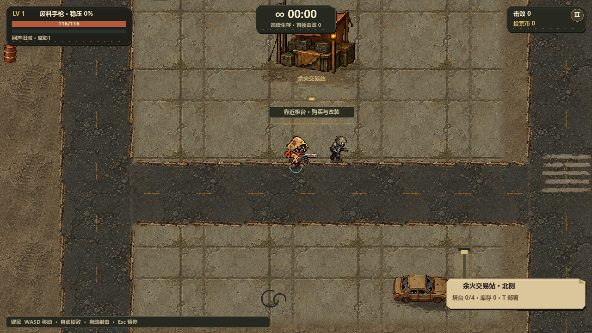
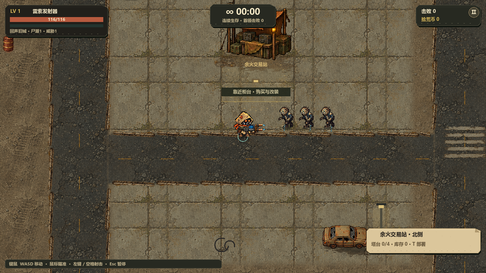
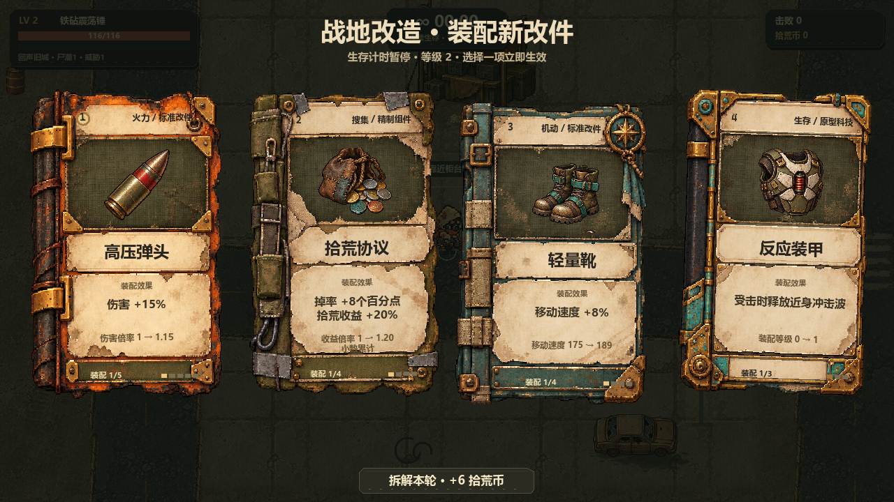

<div align="center">

# 荒原回响

**W A S T E L A N D · E C H O**

余火未熄，广播仍在。

Windows · 精细像素 · 俯视角生存射击

[](https://github.com/XFTony/wasteland-echo-windows/actions/workflows/quality.yml)


[开始体验](#开始体验) · [实机画面](#实机画面) · [开发指南](CONTRIBUTING.md) · [文档导航](docs/README.md) · [更新记录](CHANGELOG.md)



</div>

在荒废街区里走位、拾荒、改装武器，返回余火交易站补给，并用塔台守住退路。默认自动瞄准与射击，让注意力留在敌潮、地形和生存选择上。

> **当前为 Godot 原生开发预览，内部版本 `1.5.0-alpha.1`。** `main` 是当前源码入口；还没有公开的 Windows Release。实体手柄、低配电脑、系统显示缩放与长局性能仍待实机验收。[已验证范围与待办](godot/migration_status.json)

## 一局里会发生什么

**进入地图 → 走位生存 → 拾取经验与金币 → 装配改件 → 返回交易站 → 强化武器／部署塔台 → 迎接更强的敌潮**

| 玩法 | 当前内容 |
|---|---|
| 连续生存 | 三张独立地图，敌潮随时间增强；升级与交易时暂停战斗 |
| 武器选择 | 20件武器：14件远程、6件近战，包含弹丸、电链、火焰、剑气与范围重击 |
| 战地改造 | 42项升级，按武器与解锁条件提供候选；卡面显示实际属性变化 |
| 地图交互 | 交易站、补给箱、爆炸桶、掩体与可部署塔台 |
| 视听表现 | 分层人物持握、独立武器反馈、敌人受击倒地、主题音乐与分类音效 |

## 实机画面

以下均来自原生 Godot 测试窗口；战斗与卡面使用隔离验收场景，便于检查表现，不代表真人游玩成绩。截图来源见[展示素材记录](docs/screenshots/current/README.md)。

| 回声旧城 · 交易站与街区 | 武器反馈 · 电链攻击 |
|---|---|
|  |  |

**战地改造 · 实体卡面与独立改件插图**



## 开始体验

### 从源码运行

1. 下载或克隆本仓库的 `main` 分支。
2. 安装 **Godot 4.7.2 普通版**，导入 [`godot/project.godot`](godot/project.godot)。无需安装 .NET 版。
3. 等待首次资源导入完成，按 **F5** 运行。

```powershell
git clone https://github.com/XFTony/wasteland-echo-windows.git
cd wasteland-echo-windows
```

运行原生游戏不需要 Node.js；只有执行迁移对照测试和部分制作工具时才需要它。完整的[运行、测试与打包说明](godot/README.md)包含引擎路径设置和 Windows 导出步骤。

<details>
<summary>本机已有的 Windows 内部试玩包</summary>

当前已验证包位于 `output/card-layout-cleanup/windows/WastelandEcho.exe`。先正常退出旧游戏，再双击启动。该目录是本地构建产物，不包含在 GitHub 的源码下载中。

Windows 安装器、便携包及校验值待发布验收后统一放入 [Releases](https://github.com/XFTony/wasteland-echo-windows/releases)。源码 ZIP 不是可直接运行的游戏安装包。

</details>

### 基本操作

| 操作 | 键盘／鼠标 | 手柄布局* |
|---|---|---|
| 移动 | WASD／方向键 | 左摇杆 |
| 瞄准与开火 | 默认自动；可在设置中调整 | 默认自动 |
| 交易／交互 | E／Enter | A |
| 部署／确认塔台 | T | Y |
| 升级选择 | 鼠标／数字键1—4 | 导航后A |
| 暂停／返回 | Esc／P | Menu／B |

*手柄操作已实现，实体设备手感、断线重连与完整对局仍待验收。

### 存档

Godot 版使用独立的 `WastelandEcho-Godot` 用户目录，通常位于 `%APPDATA%/WastelandEcho-Godot/`。备份前请正常退出游戏。旧 Canvas／Tauri 版进度通过根目录 [`Godot存档导入与备份.cmd`](Godot存档导入与备份.cmd)显式导入，先预览、确认后写入；不会自动覆盖旧版进度。[存档工具说明](godot/README.md#开始体验)

## 开发与资源导航

**玩法开发以 `godot/` 为准，游戏逻辑统一使用带静态类型的 GDScript。** JavaScript、Python、PowerShell 分别承担旧版对照、回归测试和素材／构建工具的职责；GitHub语言占比会包含这些代码，并不等同于游戏运行依赖。

```text
godot/                  当前原生游戏：场景、GDScript、Resource、活动素材
art/                    美术与音频源文件、提示词、来源和制作记录
scripts/godot/          原生导入、验证、打包与模板准备
docs/                   设计、架构、素材索引、验收与历史记录
src/ · web/ · src-tauri/ 旧版Canvas／Tauri对照与兼容验证
test/                   旧版确定性回归
tools/                  开发工具与Godot MCP版本锁
output/                 本地截图、日志、试玩包与缓存，不进入Git
```

| 想做什么 | 从这里开始 |
|---|---|
| 修改玩法、武器、升级 | [组件与修改入口](docs/component-catalog.md) · [原生架构](docs/architecture.md) |
| 编辑地图、碰撞与场景 | [地图编辑流程](docs/design/map-editor-workflow.md) |
| 查找原图、活动素材和许可 | [资源目录](docs/assets/asset-catalog.md) · [文件夹导航](docs/project-file-guide.md) · [来源与署名](CREDITS.md) |
| 提交修改、验证与发布 | [协作指南](CONTRIBUTING.md) · [版本管理规则](docs/versioning-and-release.md) |
| 查阅清理与历史版本 | [清理与恢复报告](docs/cleanup/retirement-report.md) · [整合归档记录](docs/maintenance/github-integration-2026-10-31.md) |

GitHub 的 `Quality / check` 汇总旧版参考检查与 Godot 原生回归，两者成功才允许合并。构建与自动测试通过不替代审美确认、真人平衡或真实设备验收。

## 接下来优先做

- 用真实对局确认开局压力、20件武器手感与42项改件的选择价值。
- 完成实体手柄、Windows缩放、低配电脑与长局内存／帧率验证。
- 在已认可的回声旧城基础上，继续统一另外两张地图与其他人物服饰。
- 完成下一预发布版本的范围冻结、版本号同步、安装包及下载校验。

## 使用与署名

仓库公开用于展示开发过程，**项目整体尚未授予开源使用许可**；公开可见不代表可自由复制或商用。Godot、字体、开发工具和音效等第三方内容按各自许可处理，详情见 [CREDITS.md](CREDITS.md) 与[素材台账](docs/assets-ledger.csv)。

历史阶段的页面与运行说明已收录至[项目进度归档](docs/history/project-progress-through-2026-10-31.md)，不再与当前启动入口混排。
