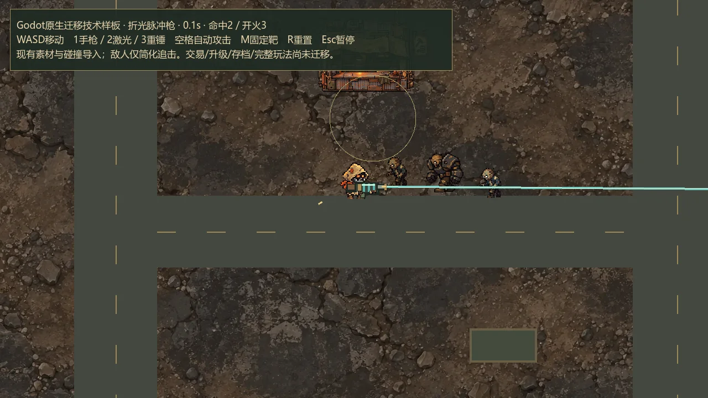

# 本机 Godot 工具连接与游戏迁移验证

日期：2026-10-29。基于武器扩展已完成的 `e96b087` 基线，隔离分支为 `codex/godot-feasibility`。本次是本机验证与迁移评估，没有用样板替换原游戏。

## 1. 结论

**现有游戏可以迁移至 Godot，已完成小范围原生技术验证。建议把 Godot 作为后续长期主开发工具的候选，继续完成一张地图的完整闭环验证，再决定全面切换。**

本次结论比上一份纯选型评估更有依据：已经在你下载的引擎上导入现有素材、建立原地图碰撞、运行角色与三武器，并通过真实MCP协议编辑了测试场景。

本次尚未证明“全部游戏已经搬完”“Godot版比现版更省内存”“最低配置已达标”或“所有制作操作都会更快”。当前样板主要由代码生成节点，还需要转成可编辑场景和资源，才能检验本人使用编辑器的效率。

## 2. 本机检查

| 检查 | 结果 |
|---|---|
| 安装目录 | `D:\Godot` |
| 主程序 | `Godot_v4.7.2-stable_win64.exe` |
| 控制台程序 | `Godot_v4.7.2-stable_win64_console.exe` |
| 实际版本 | `4.7.2.stable.official.ed1daf0bf`，由程序 `--version` 返回 |
| 编辑器类型 | 标准版；本次使用GDScript，不依赖.NET版本或C# SDK |
| 官方命令行 | 版本查询、帮助、无界面导入、原生运行与脚本验证可用 |
| 原生渲染 | Compatibility / OpenGL 3.3，在当前RTX 4060 Laptop GPU上实际截图 |
| 导出模板 | 本机所查Godot用户目录未发现已安装的版本模板；尚未验证独立Windows导出 |
| 原游戏与存档 | 原Canvas/Tauri代码未修改；样板使用单独应用数据目录，不读取正式存档 |

最初受限执行下曾出现编辑器设置保存错误；在正常本机权限下重新导入后，最终导入日志无该错误。没有关闭安全保存、杀毒软件或Windows安全功能。

Godot官方支持命令行导入、运行、脚本检查、无界面测试与导出，是当前已验证的基础控制途径。[官方命令行文档](https://docs.godotengine.org/en/stable/tutorials/editor/command_line_tutorial.html)

## 3. Skill、MCP 与命令行分别负责什么

| 类型 | 用途 | 对本项目的意义 |
|---|---|---|
| Skill | 给编码助手提供GDScript、节点、信号、资源与架构规范 | 改善代码与组织方式；本身不会点击或控制Godot |
| MCP | 把启动、读取日志、编辑场景等操作提供给助手 | 便于形成修改—运行—检查反馈的工作流；能力取决于具体服务 |
| Godot官方命令行 | 导入、运行、验证、导出；可配合项目内脚本截图 | 本轮已经可用，不依赖社区服务正常运行 |

### 3.1 已在本机实测的MCP

选择精简的 [Coding-Solo/godot-mcp](https://github.com/Coding-Solo/godot-mcp) 做第一轮测试，固定安装npm发布包 **`@coding-solo/godot-mcp@0.1.1`**，通过其真实stdio MCP协议连接。

- 服务实际列出14个工具，不根据介绍页推断额外能力。
- 本机已通过：`get_godot_version`、`get_project_info`、`create_scene`、`add_node`、`load_sprite`。
- 不仅收到了成功文本，还核对了生成的测试场景文件，确认Sprite2D与主角纹理引用已经保存。
- 该版本的 `load_sprite` 使用相对项目路径，例如 `imported/ranger-body.webp`；传入 `res://...` 会被其Node端存在性校验拒绝。本轮已实际验证正确调用方式。
- 其工具表包含运行、停止和读取调试输出，但本轮没有通过MCP验证这三项；截图/模拟按键也不在本次列出的工具中。三张真实窗口截图来自本项目编写的Godot截图脚本。
- 依赖只安装在 `output/godot-evaluation-2026-10-29/mcp/`，安装时禁用了生命周期脚本；没有改动主项目 `package.json` 或游戏运行依赖。
- **尚未注册进Codex全局或项目配置。** 当前会话的原生工具列表没有因此自动增加Godot工具。本轮通过独立测试客户端证明协议可用，不能把它表述为“Codex已经永久接入”。

可重复准备工具：[setup-mcp.ps1](../scripts/godot/setup-mcp.ps1)；实际兼容性验证：[verify-mcp.mjs](../scripts/godot/verify-mcp.mjs)。准备脚本生成可复制的 `output/godot-evaluation-2026-10-29/codex-mcp.example.toml`，不会自行覆盖现有Codex设置。

如果后续正式接入，建议使用项目级配置，并先限制为版本、项目、场景、日志与运行控制等实际需要的工具。Codex官方支持本地stdio MCP、环境变量及受信任项目的项目级 `.codex/config.toml`。[OpenAI官方MCP配置说明](https://developers.openai.com/codex/mcp)

### 3.2 其他候选与本轮未采用原因

| 候选 | 来源中声明的能力 | 核对状态与取舍 |
|---|---|---|
| [tugcantopaloglu/godot-mcp](https://github.com/tugcantopaloglu/godot-mcp) | 较多编辑/运行时工具，含截图、输入与代码执行；仓库声明测试Godot4.7 | 仓库package.json标注3.1.0，但本轮npm查询该版本返回404；不能用其最新源码版本号承诺可直接npm安装。未构建或接入，后续需要时再固定源码提交评估 |
| [slangwald/godot-mcp](https://github.com/slangwald/godot-mcp) | 编辑器插件＋Python桥，支持截图、点击和运行时场景树 | 仓库以Godot4.6为目标；当前为4.7.2，未做本机兼容验证，额外插件与通信端口暂不引入 |
| [Godot-Skill](https://github.com/shihabshahrier/Godot-Skill) | Godot4.3+ GDScript、现代API、类型、资源与架构规范 | 可作编码规范候选；本轮只核对源仓库说明，没有安装其全套安装器、钩子或改动项目指令 |
| [godot-gdscript-patterns](https://github.com/wshobson/agents/blob/main/plugins/game-development/skills/godot-gdscript-patterns/SKILL.md) | 信号、场景、状态机、资源等设计模式 | 可作较集中的参考；没有验证其所有范例在4.7.2中运行，不当作替代官方文档的保证 |

上述MCP均为社区项目，本轮没有将它们称为Godot官方工具。插件目录服务本轮两次连接失败，因此没有据此宣布目录内“没有Godot插件”；后续查证依据为作者仓库、实际npm发布信息与本机测试。

推荐先使用“一套精简MCP＋官方命令行＋项目内验证脚本”，不同时安装多套控制桥。MCP属于开发工具，不应该作为玩家运行游戏的前提。

## 4. 已完成的原生技术样板

入口：[启动样板](../experiments/godot-pilot/启动样板.cmd)、[打开编辑器](../experiments/godot-pilot/打开编辑器.cmd)、[样板说明](../experiments/godot-pilot/README.md)。

| 项目 | 实际完成与证据 | 结论边界 |
|---|---|---|
| 现有素材 | 复制16个现有运行文件，共1,163,006 bytes；WebP与WAV成功导入 | 只验证选用素材；全部菜单、服饰和装备还未逐件导入 |
| 原地图数据 | 导出回声旧城布局，17个原始障碍矩形转成Godot碰撞体；射线命中检查通过 | 没有完整迁移道路绘制、道具交互、遮挡与敌群导航 |
| 主角动画 | 原身体图集、按位移步相、独立武器/手/袖口、连续朝向 | 没有制作新的动作素材，也未做全部角度的视觉人工验收 |
| 持握数学 | 三武器×八方向，与现有JS实现的24个静态握点/枪口参考对比；最大误差0.0000171世界单位 | 只验证位置计算，不等于所有跑步、后坐和近战动作细节都已完全一致 |
| 原生移动 | CharacterBody2D与60Hz物理循环，自动验证人物实际产生位移 | 输入重绑定、手柄、失焦和所有输入兼容尚未迁移 |
| 三类攻击 | 手枪弹丸、激光射线、重锤前摇与落地，各有原生命中记录 | 复用了主要参数；完整机制、击退、消弹、有效段等尚需逐项对照移植 |
| 敌人 | 漂游者与重型敌人图集导入，简化追击/碰撞和受击 | 不是原游戏完整职业、Boss、分离、流场与刷怪实现 |
| 原生图形 | 三张截图来自真正OpenGL窗口，已目视检查；最终退出日志无错误/资源泄漏提示 | 当前机器为独显，样板负载低；不能据此宣称性能优于现版 |
| MCP场景编辑 | 测试场景中实际创建节点并保存主角纹理引用 | 没有计时比较本人地图/动画编辑效率 |

可机器读取的证据：[godot-feasibility-2026-10-29.json](qa/godot-feasibility-2026-10-29.json)。完整日志与截图在 `output/godot-evaluation-2026-10-29/`，生成素材清单保留源路径与SHA-256。

本图是技术底样，路面、地表比例和界面尚未作美术一致性迁移；不能把当前简化道路当作最终Godot美术效果。

## 5. 正式迁移的主要工作与风险

| 系统 | 可保留的成果 | 主要需要重建的部分 | 优先级 |
|---|---|---|---|
| 美术/音频 | 原始素材、许可、图集、锚点、像素比例 | 导入设置、缓存/流式策略、绘制顺序、音频总线 | P1 |
| 角色/武器 | 三角色身份、稳定ID、独立手袖结构、十二件武器与数值 | 可编辑Actor/Weapon场景、自定义Resource、攻击时序、反馈池 | P1 |
| 地图 | 三图几何、道具、交易点和素材 | 可编辑场景/TileMapLayer、碰撞与遮挡同步、导航与合法部署 | P1 |
| 战斗/生存 | 规则、现有测试样例、时间压力、实体上限 | GDScript实现、连续弹道、近战有效段、敌弹消除、对象池和刷怪 | P0 |
| 成长与交易 | 商店价格、内容引用、升级/熟练度规则 | 拾取、交易站、卡牌、塔台、结算的闭环实现 | P0 |
| 存档 | schema10、稳定ID、旧档归一化规则 | 旧程序显式导出JSON、新版验证/导入与备份；不能假设能直接读取WebView2存储 | P0 |
| 界面与操作 | 当前信息结构、美术与输入约定 | Control/Container/Theme、键鼠/手柄焦点、缩放与失焦保护 | P1 |
| 测试与发布 | 原测试的行为期望与场景数据 | Godot测试、同场景设备比较、导出模板、构建/安装/保存路径验证 | P0 |

Godot原生物理与导航可以帮助实现，但要明确伤害与碰撞的唯一来源，避免旧逻辑和新物理事件重复结算。敌群也不能不加验证地变成大量重型寻路/碰撞节点。本次简化追击未解决该问题。

## 6. 下一步实施顺序与决策门槛

| 顺序 | 下一步 | 完成标准 | 粗估有效人日 |
|---|---|---|---|
| 1 | 把技术样板改为可编辑项目结构 | Player/Weapon/Enemy/Map/HUD分场景，武器Resource在Inspector中可调；换武器或移动掩体后不改公共循环 | 2～4 |
| 2 | 完成一图最小玩法闭环 | 原始生命/伤害下，走位→击杀→拾取→升级→交易→继续生存→死亡/结算→重开，至少一件塔台 | 4～8 |
| 3 | 移植代表性复杂规则 | 连续激光/高速弹、重锤有效段与消弹、隔墙交互、三类导航尺寸，规则对照可复验 | 3～6 |
| 4 | 进行迁移决策验收 | 本人操作编辑器完成三类小改动；同设备/分辨率/实体/特效比较；旧档导入样本及原生导出通过 | 2～4 |
| 5 | 通过后才铺开全内容 | 其余武器、三图、敌人职业/Boss、全量UI、成长与存档，完成一套主开发环境 | 待闭环后重估 |

这些是为安排投入提供的粗估，不是工期承诺；学习成本、返工和新增美术另计。本次完成的是技术连通性验证，不能从此前“完整可玩对照样板”的预算中简单扣除为“已全部完成”。

关键门槛：

1. **可玩一致**：先保留现有紧凑像素方向和连续生存规则，不同时重设美术/数值。
2. **编辑有效**：本人能在Godot中移动一个掩体并同步碰撞、调整一把枪的握点、修改一次锤击效果；记录操作过程，验证工具确实减少反复改代码。
3. **设备达标**：明确一台最低目标电脑。使用Compatibility、原生导出包和相同负载对照，测帧时间、完整进程内存、启动与30分钟长局；编辑器/无界面/简化样板结果不能替代。
4. **旧档安全**：原版导出备份，新版先预览导入结果；货币、武器、行装、设置与熟练度保留。
5. **单一主线**：样板通过后才决定全面迁移；不长期维护两套不断新增功能的完整游戏。

## 7. 最终建议

**建议继续Godot方向的有界试迁移。** 本机引擎、基础控制链、素材、碰撞、三类攻击和原持握数学均已得到实际支持，技术上的不确定性已有所降低。

下一步最值得投入的是可编辑场景结构与一张地图的真实玩法闭环。完成这两项后，才能客观判断全面搬迁是否能让后续制作更高效。原游戏仍保留为体验和规则基准，不提前停用。
