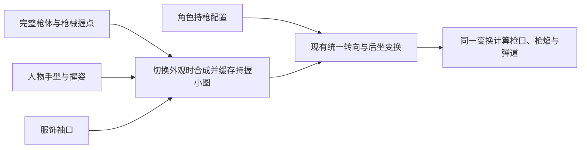

# 人物手部与枪械兼容性：调研结论和迁移方案

日期：2026-10-27。审查基线：`7510e71`，分支`codex/auto-combat-arsenal`。

状态：调研与设计完成，资源分层和运行时迁移尚未开始。用户已认可当前人物、转向和射击的整体观感；本方案以保住这版效果为迁移基准。

## 1. 结论

推荐采用：**枪械、人物手部、袖口分别保存源素材；选定人物与武器后合成为一张持握小图；运行时继续沿用现有统一转向、镜像、后坐和枪口变换。**

这里有两个独立层面：源资源决定能否换外观，统一变换决定运动是否协调。源资源可以拆分，最终持握组仍可共同运动。当前认可的步态、瞄准和自动射击规则可以继续复用。

当前二维像素角色的兼容问题，主要体现为手部图像、袖口、握持姿势、身体挂点和遮挡；不要求回到成人比例的关节动画或更换游戏引擎。

## 2. 现状与实际风险

本轮只读核对了以下实现：

- `art/characters/ranger/compact-motion-v1/metadata.json`明确记录`weaponIncludesHands=true`，身体不含枪械。
- `art/characters/ranger/compact-arsenal-v2/weapons/`及复用的手枪图，都是枪械、双手、袖口合在一起的PNG；当前`.aseprite`也是单层`weapon-and-two-hands`，没有保留独立手层。
- `scripts/animation/build-compact-arsenal.py`从合并原画导入整张持握图；其中`pivot`和`muzzle`已有数据，但没有分别标定主握点与托枪点。
- `scripts/animation/compact-ranger-motion.js`对整组素材采用同一局部变换。这是当前效果稳定的基础。其`ready()`和`drawImage()`路径已支持具有`width/height`的Canvas，可接收将来缓存合成的小图。
- 部分人体参数还混在每把枪的`rig`中，例如`chestY`、`upShoulder`；头部遮挡行数目前适配巡线者。更换体型时也需要角色自己的挂点和遮挡描述。

| 后续变化 | 直接沿用当前合并图的结果 | 需要怎样兼容 |
|---|---|---|
| 换手套／肤色 | 枪上的手仍是原来的颜色与材质 | 独立手部外观 |
| 换服饰／身甲 | 持枪袖口可能仍为旧衣服颜色 | 袖口由服饰或相应护具提供 |
| 手变大、变宽或戴护手 | 原有手型无法只靠换色解决 | 新手型和对应握姿，检查空间占用 |
| 身体高矮、肩宽变化 | 枪的位置、手臂连接和头部遮挡可能错位 | 角色持枪挂点与尺寸规范 |
| 枪型不同 | 同一种握姿未必适合手枪、长枪和重炮 | 少量持握类别＋每枪独立握点 |

当前做法适合一名角色的观感样板。若继续为每个角色复制全部七张带手枪图，维护会逐渐变为“人物外观数×武器数”的组合工作。

## 3. 调研依据与适用边界

| 原始资料 | 能确认的内容 | 对本项目的借鉴 |
|---|---|---|
| [Spine Skins官方文档](https://esotericsoftware.com/spine-skins) | 同一动画可配不同附件集合，支持服饰替换和组合角色 | 外观附件与动作分离 |
| [Spine Slots官方文档](https://esotericsoftware.com/spine-slots) | 槽位管理附件与绘制顺序，武器附件可替换，前后遮挡可独立组织 | 把武器、手指、手背与袖口明确分层 |
| [Unity SpriteResolver官方API](https://docs.unity3d.com/ja/Packages/com.unity.2d.animation@13.0/api/UnityEngine.U2D.Animation.SpriteResolver.html) | 通过类别／标签解析与替换Sprite引用 | 用语义化外观ID寻找素材，避免枪图绑定某个人物的手 |
| [Godot Marker2D官方文档](https://docs.godotengine.org/en/stable/classes/class_marker2d.html) | 使用二维位置标记提供编辑定位提示 | 主握点、托枪点、枪口采用明确的局部坐标标记 |
| [MDN Canvas优化指南](https://developer.mozilla.org/en-US/docs/Web/API/Canvas_API/Tutorial/Optimizing_canvas) | 重复绘制内容可先离屏绘制，再复用结果 | 换人物／枪械时合成一次，平时复用缓存 |

这些资料支持资源替换、槽位、挂点和缓存的通用方法。它们不证明《元气骑士》或《土豆兄弟》内部采用了完全相同的代码。本项目继续使用Canvas 2D，按现有小比例像素画面落实这些原则。

## 4. 资源与数据的归属

| 内容 | 推荐归属 | 更换时影响 |
|---|---|---|
| 完整枪体、枪柄、护木、枪托 | 武器外观 | 换武器更新 |
| 枪口、主握点、托枪点、原生画布 | 武器自身的局部坐标数据 | 改武器图时同步标定 |
| 手的轮廓、肤色、手套、掌心朝向 | 人物的手部外观资源 | 换人物／手部外观更新 |
| 袖口颜色、材质和护腕 | 服饰／身甲的表现资源 | 换相关服饰更新 |
| 身体根点、持枪高度、肩侧偏移、头部遮挡 | 人物持枪配置 | 换体型／身体图更新 |
| 握姿类别、前后绘制顺序、适用手型范围 | 持握模板 | 新枪型或新手型需要时补模板 |
| 伤害、射程、射速、弹数、自动选敌 | 现有战斗数据和规则 | 与手部外观独立管理 |

本项目已有`heroId`、`skinId`及四部位装备。手部先采用表现层的`handAppearanceId`，可由英雄、服饰和影响袖口的身甲解析得到；不需要为了美术分层就新增存档装备槽。

**重要区别：现有`pivot`是旋转／瞄准枢轴，不等于真实枪柄握点。**保留旧枢轴与枪口坐标，同时另行标定`primaryGrip`、`supportGrip`，避免为了拆手而改变枪口位置。

## 5. 源文件如何分层

每把枪应具备完整、没有手掌和人物袖口的枪体源。人物手套与袖口从武器资产中移出。

推荐制作层级为：

1. 远侧袖口与手背（需要时）。
2. 近侧手背或掌心的后方部分（需要时）。
3. 完整枪体。
4. 覆盖枪柄／护木的手指与前方手部。
5. 需要位于最前的袖口或护腕。

同一只手可以有前、后两个绘画部分，分别表达“手指包住枪柄”与“手掌位于枪后”。它们仍属于一只手的同一握姿和挂点，不是额外长出一只手。简单姿势可只使用必要的层。

不能只按颜色自动抠手：棕色手套、木枪柄、枪托和袖口存在相似颜色，颜色筛选可能损坏枪体。迁移应在原生像素源中明确标记语义区域。

**被手遮住的枪柄、扳机护圈和护木需要补绘。**当前合并图没有保存那些像素；直接挖掉手部后换成较小的新手型，会露出透明洞或残留旧手套。这是美术迁移的主要工作，也是不能承诺完全自动完成的部分。现有无手枪械概念图可作结构参考，但不能未经对齐就直接覆盖新像素图。

制作时保留现有看得见的枪体像素，只对遮挡区做必要补绘，减少整体风格变化。

## 6. 少量握姿类别，覆盖七把枪

| 模板 | 适用枪械 | 主手与辅手 |
|---|---|---|
| 双手短枪 | 废料手枪、锈痕左轮 | 主手握枪柄，辅手包住主手或靠近握把前下方 |
| 长枪前托 | 蜂群冲锋枪、破门霰弹枪、针刺步枪、余烬卡宾枪 | 主手握后握把，辅手位于该枪的护木／泵动护木 |
| 重型下托 | 荒雷线圈炮 | 主手握后方，辅手托住较厚的前下方枪体 |

同一手部外观可提供上述三种握姿，七把枪分别提供实际挂点与必要的遮挡描述。握距由枪决定，手型由人物决定；遇到明显不合适的组合，使用有记录的模板／角色例外，不强行把手图拉伸到失真。

**原版迁移允许保留按枪的手型变体。**当前七张图由不同原画导入，同一人物在各枪上的手部像素并不完全相同。为了保住认可版，首轮可把这些已有手部像素作为`poseOverrides`独立保存；不能一边强制替换为三张通用手图，一边承诺全部旧图逐像素一致。新人物优先复用类别握姿，必要时才增加局部覆盖。

换色只适合同形状的材质差异。手掌变宽、护手变厚或手指造型变化，需要相应手部图；体型差异较大还需要校对身体挂点。模块化提供可复用的结构，不会自动替代新造型的美术验收。

## 7. 保持当前动作的方法

现有`draw()`接收`assets.weapon`，其图像检查已兼容Canvas。新增合成器返回一张小Canvas即可继续走同一绘制路径；每帧无需分别追踪多个手指或重新合成。

后坐、镜像、朝向滞回和自动瞄准继续作用于整个持握组。手部外观切换不重置步相、射击冷却或目标，也不改武器伤害。

人体挂点从源数据中独立出来，最终解析出的运行时配置仍可沿用当前`rig`接口。第一版迁移为巡线者还原相同有效数值，以降低改动风险；随后新角色优先使用握姿类别配置，个别特殊组合再设小范围覆盖。

人物头部遮挡归属角色。当前巡线者的38行头部遮挡可以作为原配置保留；其他身高、头盔或轮廓需提供自己的遮挡区／遮挡蒙版。

## 8. 大手型与画布边界

新手型可能超出旧持握图边缘。合成器应按枪体、两手和袖口的联合边界扩展小画布，并返回原点偏移。

扩大画布后同时修正合成图中的枢轴和枪口坐标：两点减去相同的原点偏移，枪口相对枢轴的向量保持一致。这样可以避免裁手，也不会因为补了透明边距就改变出弹位置。

原生坐标、角色世界坐标和屏幕缩放应保持现有统一约定。手的前后部分与枪共用同一最终变换，避免分别取整造成一像素裂缝。

## 9. 缓存、启动与内存

建议只在武器、手部外观、袖口或相关资源版本变化时构建缓存；瞄准角、步相、后坐和时间不进入缓存键。

缓存键至少由武器外观版本、握点版本、手部外观／握姿版本、袖口版本和必要的左右手变体组成。多个英雄共用同一套手部外观时可共用缓存，不必重复按英雄名称创建相同图像。

游戏中加载当前外观，采用有限缓存保留当前及少量最近组合。制作预览需要同时比较七枪时可缓存该人物的七个组合。资源更新和换外观时释放旧结果，避免累积所有“人物×服饰×枪械×角度”。普通离屏Canvas即可起步，不要求引入Worker或额外动画引擎。

当前七张合并持握图共6942字节，解码像素为28192字节，约27.5KiB。以下仅是按像素尺寸计算的方案估算，不是实测进程内存：

- 若完整枪体仍使用同尺寸画布，七枪基础图的像素上界约27.5KiB。
- 另缓存当前人物的七张持握组合，约再增加27.5KiB。
- 假设三类握姿、每类两手、每手8×8像素，一套手图约1.5KiB；袖口另计。
- 首轮原巡线者若保留七把枪各自的手型变体，按七枪×两手×8×8估算约3.5KiB；这些是已有手部像素的分层保存，不需要重新绘制七套完整枪体。
- 这种全七枪预览的相关像素合计约57–59KiB加袖口，比现状约增加29–31KiB加袖口。实际PNG压缩、画布扩边、手型尺寸和浏览器对象开销需测量。
- 角色身体图集可继续复用；正式游戏只缓存所需组合时，开销可以更小。

因此，预计可在很小的资源规模下完成，不能承诺内存完全零增长。首个样板应对比冷启动、首次换装／换枪、连续切换后的内存趋势；正常逐帧播放期间，缓存命中不得触发重新合成。

## 10. 推荐迁移顺序与通过条件

| 顺序 | 工作 | 可审看的交付与通过条件 |
|---|---|---|
| 1 | 固定认可基准 | 保留`7510e71`、现有七张图、112组方向检查与视频，作为对照 |
| 2 | 只拆两把代表枪 | 废料手枪＋针刺步枪；完整枪体、原手套与袖口分层，补足遮挡处，标定两个握点 |
| 3 | 建立两套真正不同的手部外观 | 原布手套＋较宽的护手型，不能只换色；先验证相同身体上的换手，再用后续第二名正式角色验证体型挂点 |
| 4 | 实现独立合成器与缓存 | 当前外观合成图与旧图逐像素一致；缓存尺寸／原点正确；原角色动作和枪口数值不变 |
| 5 | 验证四个基础组合 | 两把枪×两种手型，逐项检查八方向、静止／后坐、移动、自动切敌、停步、遮挡和袖口连接 |
| 6 | 迁移其余五枪 | 使用已证明可行的类别与数据；七枪都具有无手完整枪体和独立外观源 |
| 7 | 记录真实成本并接入角色换装 | 按实际修画和缓存成本扩展；确认新角色的挂点及遮挡后再认定兼容 |

前四步的重点是资源分层与小型合成器，工作量可控；最大不确定性在补绘遮挡区域和不同手型的自然握持。先实测两把枪，再估其余五把，不用“都是小图”推断所有组合可以自动完成。

## 11. 必须覆盖的验收

- 默认巡线者＋原手套：合成后的像素、画布和有效挂点与认可版一致；相同输入下转向、后坐与枪口位置不回退。
- 换人物／手套／服饰：枪体和武器数值不因外观切换改变；手、袖口来自选定外观，没有旧手套残留、透明洞或被裁的手指。
- 新手型的手指位于正确前后层，能包住枪柄／护木，枪械不穿过手心。
- 七枪×八方向×静止／最大后坐的112组检查继续执行；两种手部外观至少224组基础组合。新角色还要增加身体连接与头部遮挡评审。
- 连续开火、自动换敌、暂停、失焦和换枪继续通过现有回归；手部切换不重启步态和冷却。
- 非对称手部有明确左右资源或镜像约定；不能把左右手掌的朝向随意互换。
- 不兼容或缺失的外观在制作验证中明确报出；仅对仍使用原巡线者外观的旧素材提供原合并图回退，不把旧手套静默套到新人物。
- 缓存命中时不重建；切换后旧对象可释放；像素估算与实测内存分别记录。

## 12. 本次完成边界

本次交付是针对当前源码和已认可素材的兼容性方案，未修改角色图、枪图、动作程序或战斗数值。上述分层源、新手型、合成缓存和224组验证是后续实施任务，不列为已完成。

建议将“资源可替换”与“新人物握持好看”分别验收：前者由资源契约与测试证明，后者由实际新造型的像素和动作画面证明。
