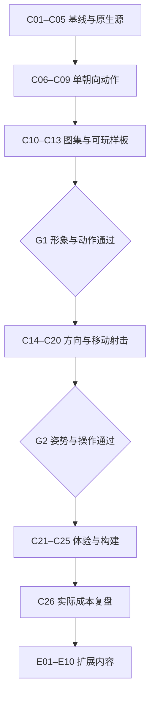

# 《荒原回响》精细像素角色动画完整实施工作计划

> 历史计划1.0：审核后的当前排程、预算、验收与回退请以 [最终计划2.0](./pixel-animation-final-plan-2026-10-02.md) 为准。本文保留原详细方法和数字，以便追溯。

> 制定日期：2026-10-01，北京时间。
> 计划版本：1.0。性质：待执行的工作计划；已存在的参考素材和调研结果单独标明。
> 当前基线：`2504ed8`，开发分支 `codex/ranger-pixel-lookdev`。
> 项目：`D:\DeskBox\XF Tony\DeskBox\Wechat games`。
> 首个制作对象：巡线者 `ranger`、默认服饰 `wanderer`、废料手枪 `scrap_pistol`。

## 阅读目录

1. 目标、范围与实施原则
2. 当前项目的真实状态
3. 制作方法、工具与责任
4. 视觉、动作和性能规格
5. 核心工作总表与依赖
6. C01–C26 逐步实施方法
7. 验收矩阵与主要风险
8. 后续全内容扩展 E01–E10
9. 工作量、成本判断和排期方法
10. 文件结构、数据契约与 Git 管理
11. 实施工作单元与交付清单
12. 参考依据与计划更新规则

---

## 1. 目标、范围与实施原则

### 1.1 最终要解决的问题

让游戏里的角色从整张贴图浮动，进化为形象一致、动作自然、方向协调、可以持续扩展的二维精细像素人物。保留已有废土身份：兜帽、面罩、橙色镜片、围巾、破旧外套和实用枪械。

第一阶段的价值由实际游戏中的移动、瞄准和射击来证明。静态目标图、模型文件、图片数量与自动测试数量，都不能单独作为动作完成的依据。

### 1.2 范围分成三层

| 层级 | 本层要完成的内容 | 本层结束的实际标志 |
|---|---|---|
| A：单朝向可玩样板 | 一名巡线者、默认服饰、起始手枪；原生像素源、8 帧跑步、射击关键姿势、图集及游戏接入 | 可以在内部游戏移动和开枪，确认形象、握持、步态和制作成本 |
| B：巡线者完整方向样板 | 先以四个身体朝向组织制作，核对连续瞄准、斜向移动、侧步、后退、移动射击、转向与停步 | 用户指出的腰扭、脚尖、上下身、手枪方向问题得到实际修正；四向不足时补八向 |
| C：全内容迭代 | 普通敌人和 Boss、其余英雄与服饰、武器姿势家族、装备、地图与特效，最后公开发布验收 | 制作方法能复用；全部活动战斗内容的视觉和 Windows 体验完成统一验收 |

四方向是控制制作规模的初始验证方案，不是牺牲瞄准精度的最终承诺。只要四方向人物在斜向瞄准时明显失真，八方向补绘就提升为当前必要工作。

### 1.3 实施原则

- 保留 Canvas 2D、当前世界模型、固定 60 Hz 逻辑、内容 ID 和存档。人物动画优先作为表现层实现。
- 优先采用二维原生像素制作；Blender 保留为可选姿势、透视参考，不继续把精细建模设为前置条件。
- 一个完整可玩样板通过后再铺开内容，不同时批量制作九套英雄服饰和全部敌人。
- GIF 用于审看和交流；正式运行使用透明帧图集和帧时序数据。
- 每段动作先设计受力明确的关键姿势，再补中间帧。8 帧是起始工作规格，不是任何动作都必须使用 8 帧。
- 少量姿势组成自然动作；不要用整图缩放、正弦摆腿和任意上身旋转来代替新的姿势。
- 全身姿势在同一源里校对；只有接缝和遮挡稳定后才拆运行层。复杂组合允许使用少量整身专用帧。
- 已有原画、地图和 UI 作为现成基础与参考，不因路线变化重复生成同一批素材。
- 关键阶段做完整成果评审，日常修正依据已经明确的标准继续推进，避免每个小步骤都等待一次确认。

### 1.4 完成标准

角色在正常游戏尺寸下能认出身份；前跑、后退和侧步可区分；脚底、膝盖、骨盆、上身与瞄准关系协调；双手与枪稳定；开火与实际弹丸同步；停步、撞墙和暂停正确；启动与长局资源占用符合测量目标。

用户保留对形象、风格与动作观感的评审权。自动检查负责坐标、文件、时序和运行错误，人工目视负责人体姿势、像素轮廓、装备遮挡和审美。

## 2. 当前项目的真实状态

以下为制定计划时已读取的源码与本轮之前的记录。此计划没有重新进行全部游戏测试、远端核验或真人长局。

| 已有内容 | 当前状态 | 如何使用 |
|---|---|---|
| 静态厚涂角色与枪械 | 游戏中已接入；人物仍是整图浮动和左右镜像 | 保留为活动回退与身份参考 |
| 精细像素巡线者样稿 | `ranger-pixel-sidearm-v1.png`，1254×1254 RGBA，864,484 bytes，透明背景 | 作为造型底稿；手枪已绘入，尚非原生低分辨率源或动作图集 |
| 像素风对照页 | 76px、152px、304px 与背景切换已验证 | 复用页面布局，增加帧播放与动作评审，不重新搭建同类页面 |
| 旧 Blender 跑步源 | 有骨架、步态和握点实验，用户认可过部分跑步节奏 | 仅作参考；旧方向与衣物问题不能作为已通过姿势沿用 |
| 未提交的三维细化实验 | 当前工作区仍有模型、脚本与材质实验；记录存在靴子穿插 | 先独立归档其状态，不混入像素成品提交 |
| 活动资源系统 | `ArtStore` 支持资源目录、按需请求、按组释放 | 扩展图集加载与准备状态，不另造一套完全独立缓存 |
| 构建系统 | 现有桌面 staging 会复制活动资源，CommonJS 模块进入 bundle | 帧元数据先作为 JS 模块，避免增加未覆盖的运行 JSON 文件加载链路 |
| 开枪事件 | `CombatSim.fireWeapon()` 发出 `shot`，特效层已消费 | 用实际开枪事件触发动画，不用鼠标按下代替成功开枪 |
| 初始射速 | 手枪间隔 0.35 秒、冲锋枪 0.105 秒，升级会进一步变化 | 分离单发反应与连射策略，不为每一枪播放固定长整身片段 |
| 出弹与枪口 | 规则弹丸从中心沿射向偏移 14；特效使用枪械 `muzzleLength`，人物枪械又有独立显示挂点 | C18 专门设计坐标映射，不能默认三者已经一致 |
| 其他内容 | 历史覆盖记录：9 个英雄服饰组合、8 类敌人、7 把枪、8 件护具图标、3 张地图 | 用于估计扩展范围，不把图标齐全当作穿戴或动画完成 |

源码重点：`src/render/illustrated-actors.js`、`src/render/actor-view.js`、`src/render/fx-system.js`、`src/render/art/art-store.js`、`src/render/art/asset-catalog.js`、`src/core/combat-sim.js`、`scripts/stage-desktop.mjs`。

## 3. 制作方法、工具与责任

### 3.1 方法选择

主流程：**角色样稿 → 原生像素源 → 关键姿势 → 连续透明帧 → GIF／网页评审 → 图集与锚点 → 游戏控制 → 实际试玩**。

二维源承担形象、轮廓和动作一致性。脚本承担导出、打包、元数据、文件检查和运行播放。生成工具主要补充明确缺失的设计参考，不承担“多次随机生成就能组成稳定动作”的假设。

### 3.2 工具表

| 工具 | 用于什么 | 使用前要确认什么 | 状态与成本判断 |
|---|---|---|---|
| Aseprite 或其他现有像素编辑器 | 原生网格、调色板、帧、图层、姿势修整 | 本机是否已有可用安装／许可；能否导出透明帧和层 | Aseprite 安装未核实。它是候选，不作为必须购买的软件 |
| LibreSprite／Krita 等 | 现有工具不足时的二维源候选 | 像素笔刷、动画帧、透明导出、源格式能否满足本项目 | 先做小导出验证，选定一种主源，避免维护多个编辑器版本 |
| ImageGen 内置工具 | 已有角色设计参考，必要的侧背面或缺失造型参考 | 参考是否明确、输出是否能保持身份 | 可生成静态样稿；目前没有已验证的自动多方向成品动画流程 |
| Python＋Pillow | 图像尺寸、透明度、调色板统计、图集打包、哈希、GIF 合成 | 导出接口与参数稳定、打包没有偏移 | 项目已有使用基础；新脚本以复用现有工具为主 |
| Node／Canvas 2D | 动画选择、步相、射击反馈、资源生命周期 | 与现有渲染和构建接口一致 | 当前游戏基础，修改范围集中在表现层 |
| Playwright＋Edge | 页面加载、控件、截图、视口与运行错误 | 复用当前本地测试方式 | 已有基础；不为纯文案或小图修整反复跑全部游戏测试 |
| Blender | 姿势／透视／步态参考 | 是否确实减少二维修画时间 | 已有模型可用，但不作为该计划的必需工具 |
| 专业图生视频工具 | 可选动作草稿或运动参考 | 工具是否可用、角色一致性与相机是否固定 | 未建立可用链路。核心计划不依赖此工具 |

像素源修整需要可编辑网格和逐帧造型能力。不能把“人工修画”写成已经验证的全自动功能。执行者负责寻找可落实的制作与修整方式；用户主要做成果评审，不默认要求用户自己逐像素绘画。若连续两个有限范围样板仍无法达到标准，再评估专业像素美术协助或更简单的细节密度。

### 3.3 责任分配

- 执行者／Codex：核对基线、组织文件、辅助素材制作、开发工具、接入、验证、记录和修正；如实区分完成与待完成。
- 二维制作责任：落实原生源、姿势与逐帧修整；可由具备能力的执行者完成，困难时再评估美术协助。
- 用户：评价角色身份、风格、动作自然度，试玩关键样板，提供实体手柄和 Windows 体验反馈。
- 脚本：检查文件、透明度、边界、锚点、帧时序、循环、资源和事件行为；不取代审美评审。

## 4. 视觉、动作和性能规格

### 4.1 首轮视觉规格

| 项目 | 初始候选 | 确定方法 |
|---|---|---|
| 角色身份 | 兜帽、橙镜片、面罩、围巾、外套、深裤和靴子 | 与现有两张原画和像素风样稿并排核对 |
| 显示尺度 | 1280×720 参考视野下约 76 世界单位高；另看 152px 放大效果 | C03 锁定，避免每个动作自行改高度 |
| 像素密度 | 候选 A：人物约 38 原生像素、参考尺寸放大 2 倍；候选 B：人物约 76 原生像素、参考尺寸 1 倍 | 用同一姿势做比较，倾向能体现面罩和握持的方案，实际图面决定 |
| 源画布 | 64×96 或 128×128 候选，保留枪和动作余量 | 身体高度与画布大小分别定义；C03 后只保留一个主规格 |
| 颜色 | 首轮目标约 24–40 色，布、皮、金属各有明确明暗层次 | C04 检查实际色数、轮廓与地图可读性，不把生成提示词当成已达标 |
| 光源 | 固定画面左上光源和受控阴影 | 转向时光源保持场景关系，不随角色脸部旋转 |
| 透明边缘 | 清楚轮廓，去除无意义半透明碎点；需要的半透明特效独立层 | 放到深色、浅色和地图背景检查 |
| 人物比例 | 成人比例与清晰剪影，保留当前身份 | 不照搬其他游戏角色或强制改为大头 Q 版 |
| 字体与 UI | 保留清晰中文正文和已有信息层级 | 像素角色变化不要求重新制作全部字体与菜单 |

非整数窗口缩放下的像素密度和抖动要实际测量。第一方案沿用现有固定世界视野；如果最近邻绘制出现明显轮廓闪烁，再评估固定战斗绘制缓冲的成本，不预先重写整个摄像机系统。

### 4.2 动作规格

- 前跑以 8 帧为起点，先设计左右落脚、下沉、经过、蹬地四类姿势，再组织完整循环。
- 射击先画 4–6 个关键姿势：待机、开火、后坐峰值、恢复过渡、回位；必要时补成 6–10 个显示帧。
- 手枪反应先试约 0.18–0.22 秒，属于视觉试验值，不改变 0.35 秒的基础发射间隔。
- 侧步和后退独立设计脚路、步长、支撑时长和重心，不直接反放前跑素材。
- 移动步相以实际世界位移与片段步长推进；动画帧数、播放速度和 60 Hz 逻辑分开管理。
- 身体朝向、脚尖、移动与枪口分别记录。后退和侧步时允许脚尖朝向身体，但姿势必须明确表达该种移动。
- 大幅扭腰不作为方向不足的补救方法；对齐不足时补姿势或朝向。
- 左右镜像只作制作参考；持枪主手、补丁、滤罐和装备的左右关系需要逐项修正。

### 4.3 初始资源与性能目标

- 主菜单不提前请求全部人物动作图集；部署时准备所选英雄、服饰和武器家族。
- 单朝向首份样板新增压缩图片目标不超过 1.5 MiB；活跃图集 RGBA 像素估算目标不超过 8 MiB。
- 四向巡线者完整样板同时活跃图集像素目标不超过 16 MiB；相对静态版进程增量先以约 24 MiB 为工作预算，实际测量后修订。
- 这些是初始工作预算，不是已验证承诺。超预算先查空白、过大分辨率、重复层、缓存和加载范围，再决定合理调整。
- 1080p 常规目标约 60 FPS，1% low 目标至少 50 FPS；最低测试环境以持续 30 FPS 为下限。明确区分目标与最低环境下限。
- 同一设备、场景、敌人数、质量档、窗口大小和运行时间对比静态基线；Headless 浏览器数据只作辅助。
- 真实 WebView2 长局至少 10 分钟；检查回菜单、重开、反复切图后的内存趋势。释放引用不意味着操作系统立刻归还全部内存。

## 5. 核心工作总表与依赖

优先级：P0＝首个可玩样板关键路径；P1＝完整方向、体验与正式扩展前需要；P2＝样板过关后的内容扩展；P3＝有明确需要再投入。

工作量单位为“有效人时”，包含制作、编码、目视修整和对应验证，不包含等待生成服务、下载、用户反馈等外部时间。范围只是计划估计，C07 与 C13 后必须用真实制作时间重估。

| ID | 阶段／工作 | 优先级 | 依赖 | 估计人时 | 初始状态 |
|---|---|---|---|---:|---|
| C01 | 基线保护与旧实验归档 | P0 | 无 | 2–4 | 待执行 |
| C02 | 编辑器验证与源格式约定 | P0 | C01 | 2–4 | 待执行 |
| C03 | 像素密度、比例、调色板规范 | P0 | C02 | 4–8 | 待执行 |
| C04 | 原生像素角色主源 | P0 | C03 | 6–14 | 待执行 |
| C05 | 图层、身体部位、锚点及握枪源 | P0 | C04 | 3–6 | 待执行 |
| C06 | 前跑关键姿势设计 | P0 | C05 | 4–8 | 待执行 |
| C07 | 单朝向 8 帧跑步与修画 | P0 | C06 | 6–14 | 待执行 |
| C08 | 手枪射击关键帧 | P0 | C05；C07 可并行小批 | 4–10 | 待执行 |
| C09 | 动态评审页与 GIF | P0 | C07、C08 | 2–4 | 待执行 |
| C10 | 图集、锚点与导出检查 | P0 | C09 | 3–6 | 待执行 |
| C11 | 表现层动画控制器 | P0 | C05 契约、C10 | 4–8 | 待执行 |
| C12 | 单朝向内部游戏接入 | P0 | C10、C11 | 4–8 | 待执行 |
| C13 | 第一份可玩样板验收与成本记录 | P0 | C12 | 2–4 | 待执行 |
| C14 | 四向静态体积与身份补绘 | P1 | C13 通过 | 6–14 | 待执行 |
| C15 | 四向同向跑步 | P1 | C14 | 6–12 | 待执行 |
| C16 | 侧步、后退与斜向过渡 | P1 | C15 | 12–32 | 待执行 |
| C17 | 自由瞄准、持握与方向切换 | P1 | C14、C05 | 8–18 | 待执行 |
| C18 | 移动射击与枪口／弹道对齐 | P1 | C16、C17 | 4–10 | 待执行 |
| C19 | 连射、后坐和特效调校 | P1 | C18 | 2–4 | 待执行 |
| C20 | 待机、停步、转向、受击与死亡 | P1 | C15；与 C16–C19 分批交错 | 4–10 | 待执行 |
| C21 | 键鼠、手柄与多窗口阅读检查 | P1 | C18、C20 | 2–4 | 待执行 |
| C22 | 图集、缓存、包体与内存优化 | P1 | C21 | 3–6 | 待执行 |
| C23 | 回归、实际窗口与长局验证 | P1 | C22 | 4–8 | 待执行 |
| C24 | 有针对性的观感修正 | P1 | C23 证据、试玩意见 | 4–10 | 待执行 |
| C25 | 文档、素材台账与内部构建 | P1 | C24 | 2–4 | 待执行 |
| C26 | 生产成本复盘与扩展决策 | P1 | C25 | 2–4 | 待执行 |

### 核心依赖路径



关口不通过时，回到造成问题的步骤修正。已有通过内容保留，避免把整个样板推倒重来。

## 6. C01–C26 逐步实施方法

### C01 · 基线保护与旧实验归档

**目的：**让当前可玩的静态游戏、像素试作和旧三维实验都有明确的恢复位置。

**方法：**读取 Git 差异和资源清单，按内容来源分组，建立精确的归档提交或独立分支；确认运行基线与精选截图。

**具体步骤：**

1. 记录当前提交、分支、工作区修改、活动版本与当前启动入口。
2. 将旧三维脚本、模型、材质及失败验证记录单独登记，注明“参考／未验收”；保持原文件可恢复。
3. 对像素样稿、已完成调研和活动运行素材分别记录状态。
4. 复用当前静态游戏作为试玩与资源基线，保存少量有价值的截图，不重复生成全部页面。
5. 按项目规则备份开发分支；精选输出另行备份，因为 `output/` 被 Git 忽略。

**交付与验收：**基线记录、归档范围、可恢复提交／分支、静态游戏入口；没有把失败三维素材注册为活动像素资源。

**工作量：2–4 人时。合理性：**主要是整理，已有文件与 Git 结构可复用。若远端访问不可用，先完成本地记录与其余制作，把远端备份单列为待处理事实。

### C02 · 编辑器验证与源格式约定

**目的：**确保真正能制作、修画和导出原生像素帧，避免只生产无法编辑的图片。

**方法：**选择已有可用的二维像素工具，做最小导出验证；先定接口，再决定是否需要增加工具。

**具体步骤：**

1. 核对本机现有编辑器和许可；优先已有工具。
2. 建一个小画布，验证像素笔刷不自动平滑、调色板可保存、多个帧可编辑。
3. 画两帧不同姿势，分别导出透明 PNG、图层和帧时间；验证读取结果与源一致。
4. 确认能保存可编辑源。主格式选择一种，PNG／JSON 作为交换接口。
5. 工具不足时只增加所需最小能力；不先购买软件或安装大量插件。

**交付与验收：**可编辑试验源、两帧导出及源格式说明；能够重新打开、改一帧、导出并读回。

**工作量：2–4 人时。合理性：**验证工具即可，不开发通用动画编辑器。若本地工具完全不可用，先报告缺口并调整方法，而非把该步骤默认标为完成。

### C03 · 像素密度、比例和色彩规范

**目的：**确定人物在真实游戏尺寸下的细节密度和识别度。

**方法：**同一角色、同一姿势、同一背景，比较 38 与 76 像素左右的原生身体高度候选；限制比较次数。

**具体步骤：**

1. 选现有巡线者身份参考，不重复生成整套原画。
2. 组织两种像素密度候选；使用有代表性的面罩、袖口、枪和靴子细节。
3. 在 76px 参考显示高度与 152px 放大视图比较；同时看原生网格。
4. 确定头身比例、肩宽、衣摆长度、鞋底、光源、轮廓线和材料色数。
5. 检查地图地面是否抢视线；选择一组确定规格，记录弃选原因。

**交付与验收：**一页视觉规范、两种候选对照、主画布／身体高度／调色板；角色身份清晰且细节可重复绘制。

**工作量：4–8 人时。合理性：**最多两种候选、一次集中修正，不持续生成十几个风格方案。密度增加必须对应可见收益。

### C04 · 制作原生像素角色主源

**目的：**得到可以逐帧修改的正式造型基础。

**方法：**在固定像素网格上依据参考重新组织轮廓和材料色块，逐件修整，而不是把高分辨率样稿简单缩小后直接认作完成。

**具体步骤：**

1. 用确定画布画出成人身体和服饰的主剪影。
2. 先画兜帽、面罩、围巾、外套、裤腿和靴子的大明暗区，再加入必要补丁与挂件。
3. 整理像素簇：清除无意义单点、交错噪纹和不稳定的半透明边缘。
4. 为手、袖口和枪之间保留可读空间；控制重要部位的对比。
5. 分别在纯色和现有地图上检查；保留精细身份但删减不可见的微小纹理。

**交付与验收：**原生可编辑源、原生尺寸 PNG、调色板、制作记录；源网格真实存在，透明边缘与材料区分稳定。

**工作量：6–14 人时。合理性：**这是一名角色的主源，前期较费工，后续帧应复用已锁定造型。若超过两次集中修整仍无法形成可用主源，先降低细节密度或补制作能力，不直接进入几十帧动作。

### C05 · 图层、身体部位、锚点与握枪源

**目的：**为动作和换枪保留结构，同时避免分层纸偶感。

**方法：**先在完整人体姿势中设计，再建立少量有意义的源图层。运行层是否拆分由实际接缝效果决定。

**具体步骤：**

1. 主源按下身、躯干／头部、双臂与手、枪械、前后衣摆、独立特效组织；避免每根手指都成为一个运行图层。
2. 画出一份不含烘焙枪械的身体源，再制作手枪持握组。
3. 定义脚底根、骨盆、两手握点、枪口、前后绘制顺序。
4. 双手明确：主手握柄，支撑手包覆；待机食指与开火扣指分别设计。
5. 验证衣摆能遮住自然接缝，不出现多余垂下手臂或手枪悬空。

**交付与验收：**图层说明、锚点表、独立枪械源、完整持枪源；整体人体姿势先成立，拆层后能复原同一画面。

**工作量：3–6 人时。合理性：**只制作起始手枪所需结构，预留家族接口；暂不制作七把枪全部手部组合。

### C06 · 前跑关键姿势设计

**目的：**先解决跑步的受力、比例和脚路。

**方法：**设计少量关键姿势，使用已有认可节奏和动作参考作辅助，逐姿势核对身体结构。

**具体步骤：**

1. 画左脚落地、下沉、右脚经过、蹬地／抬脚，再画左右换位。
2. 标出支撑脚、摆动脚、骨盆位置、膝盖弯曲和脚尖方向。
3. 给同一动作确定步长与周期的候选关系；不改游戏速度。
4. 先以低速关键帧序列查看，再看正常播放。
5. 修正交叉腿、长短变化、滑地、过大弹跳和衣摆遮住全部步态的问题。

**交付与验收：**关键姿势表、支撑说明、候选步长；无衣物纹理干扰时仍能看出自然跑步。

**工作量：4–8 人时。合理性：**此阶段有问题就在少量姿势上修改，避免绘完 8 帧后再推翻全部受力关系。

### C07 · 单朝向 8 帧跑步与像素修画

**目的：**得到一段保持角色身份、能循环播放的实际像素动作。

**方法：**补足过渡姿势，逐帧整理轮廓、衣物与关键部位，按确定时序播放。

**具体步骤：**

1. 从 C06 补成 8 帧完整循环；每帧有明确的身体变化。
2. 在帧间保持头身比例、面罩、补丁位置和材料职责。
3. 衣摆与围巾跟随身体运动，幅度小于主体步态，不用整图拉伸。
4. 检查两次落脚、循环接缝和脚底锚点；需要时增补个别帧或调整停留时间。
5. 记录每帧制作与修整时间、被推翻的原因和可复用比例。

**交付与验收：**8 帧原生源与 PNG、时序与步长记录；慢速、正常和逐帧播放均无明显人体变形。

**工作量：6–14 人时。合理性：**单朝向是首个实际生产计量点。若单帧有效制作时间明显高于估计，立刻重算方向扩展工作量，而非继续使用原计划数字。

### C08 · 起始手枪射击关键帧

**目的：**让双手、手腕、肘、肩和枪在开火时共同反应。

**方法：**绘制 4–6 个射击关键姿势，按反应时长补帧；从已经持枪的待机状态开始。

**具体步骤：**

1. 制作待机、开火、后坐峰值、恢复和回位姿势。
2. 射击主手和支撑手保持稳定，不改变握枪身份；检查扳机护圈与滑套位置。
3. 枪口轻微上抬，手腕与肩肘跟随；下身在原地样板中保持稳定。
4. 套筒、弹壳和枪口闪光作为可选独立反馈；完成主体反应后再补。
5. 比较约 0.18–0.22 秒候选时序，保留清楚且响应快的方案。

**交付与验收：**射击源、关键帧／必要中间帧、同一持握组的锚点；开火阶段可辨，恢复能回到待机，不每枪重复抬枪。

**工作量：4–10 人时。合理性：**只做一把枪和一个朝向，不扩成长枪、近战或多方向电影镜头。

### C09 · 动态评审页与 GIF

**目的：**让动作错误能够被定位到具体帧，便于用户审看。

**方法：**扩展现有像素对照页，增加播放、暂停、逐帧、速度、动作与接地参考；GIF 从同一帧源合成。

**具体步骤：**

1. 复用现有静态评审页，保留 76px 与 152px 对照。
2. 加入动作选择、时间轴、慢速、逐帧、根／脚／枪口锚点显示。
3. GIF 用于快速分享；网页保留每帧定位能力。
4. 帧缺失或导出不完整时显示具体错误，禁止将新旧帧混合成已完成结果。
5. 检查页面加载、控件和固定相机尺度。

**交付与验收：**动态 HTML、GIF、关键帧对照；两者来自同一套源帧，能复现同一动作。

**工作量：2–4 人时。合理性：**当前已有页面与浏览器测试方式可复用；不建设通用在线动画平台。

### C10 · 图集、锚点与导出检查

**目的：**得到轻量、可追溯、能够直接被游戏使用的动作资源。

**方法：**共享裁切原点和尺度，打包透明帧；生成锚点、时序、姿势标识和资源版本。

**具体步骤：**

1. 统一身体参考高度与脚底根；每帧裁切后保存根位置，不用可见边界中心当脚底。
2. 打包 PNG 或无损 WebP 图集，预留合理间距，避免边缘串色。
3. 输出帧矩形、时长、根、两手、枪口、支撑状态、片段步长和绘制层序。
4. 检查帧数、空帧、越界、缺文件、循环、锚点与版本；生成源码可引用的 CommonJS 数据模块。
5. 源帧、GIF 和编辑器文件留在制作目录；活动树仅含验收图集与运行数据。

**交付与验收：**图集、JSON 制作元数据、运行 JS 数据、哈希和导出报告；从源重建可得到相同帧序与锚点。

**工作量：3–6 人时。合理性：**只满足本角色契约，复用现有 Python／构建，不写万能素材管理器。

### C11 · 表现层动画控制器

**目的：**把逻辑位移与实际开枪转成正确的视觉状态。

**方法：**在表现层建立实例状态，消费位移、瞄准和 `shot` 事件，不写入存档。

**具体步骤：**

1. 记录上一位置、当前片段、步相、朝向、射击反应时间及资源准备状态。
2. 用真实位移／片段步长推进步相；输入按住但实际没有移动时停止推进。
3. 按实际开枪事件触发反应；不能将鼠标按下次数当作射击次数。
4. 暂停冻结，失焦／重开清理，异常大位移重置；停步与方向切换保留合理步相。
5. 用少量必要测试覆盖撞墙、暂停、重开、时序和事件，不写只重复实现细节的测试。

**交付与验收：**独立动画状态模块与行为测试；动画改变不影响伤害、射速、碰撞和存档。

**工作量：4–8 人时。合理性：**现有模型和事件可以复用，暂不重构全部战斗会话。

### C12 · 单朝向内部游戏接入

**目的：**让用户能够体验一名真正会移动和射击的角色。

**方法：**仅在巡线者默认服饰与起始手枪使用新样板；用开发入口明确限制当前朝向，不将其他方向未完成的效果冒充全方向样板。

**具体步骤：**

1. 将已验收图集注册到资源目录，部署时加载所选样板。
2. 在角色渲染中接入新数据、层序与控制器；使用现有世界到屏幕变换。
3. 保留图片未准备好时可操作的静态回退；准备完成后平稳进入动画状态。
4. 提供明确的内部试验开关和操作说明，不直接替换所有英雄与敌人。
5. 检查暂停、重开、回菜单、重新部署与资源准备期间操作。

**交付与验收：**可玩的单朝向内部样板；真实移动速度下动作清楚，资源缺失仍能操作。

**工作量：4–8 人时。合理性：**这一步必须尽早完成，避免继续只在离线页面验证。它不是新的公开发行版本。

### C13 · 第一份可玩样板验收与成本记录

**目的：**判断这条路线是否同时满足质量与生产成本。

**方法：**先在真实尺寸试玩，再逐帧定位问题；记录实际工时与资源，而不是用图片数量计算完成率。

**具体步骤：**

1. 审看人物身份、成人比例、面罩、双手握持、落脚、衣摆和循环。
2. 试玩移动、停步、撞墙、开火和暂停，检查操作响应。
3. 记录制作、修整、编码、测试各自用时；记录帧数、压缩字节和解码像素。
4. 将问题限定到造型、姿势、导出、状态或坐标中的具体一项。
5. 决定继续、针对性修正或缩小细节；通过 G1 后再开始 C14。

**交付与验收：**第一份试玩结论、问题表和实际成本表；至少一段可玩的跑步与射击，而非单张目标图。

**工作量：2–4 人时。合理性：**集中评审一次，小问题继续修；若需要较大返工，应记录为新的实际工时，而不是偷偷算入“已完成”。

### C14 · 四向静态体积与身份补绘

**目的：**补齐侧面与背面结构，让转向时仍是同一个巡线者。

**方法：**围绕同一原生主源绘制前、后、左、右代表视图，固定相机与光源；原画与少量设计参考辅助形体判断。

**具体步骤：**

1. 先确认前、侧、背的兜帽体积、肩宽、衣摆长度、腰带与靴子。
2. 为不对称补丁、面罩滤罐、包具和主手建立各视图对应关系。
3. 左右镜像可以作为草图，但逐项修正左右身份与阴影。
4. 对齐身体高度和脚底根；检查背身时武器被身体合理遮挡。
5. 补绘少量斜向静态草图，提前发现四向难以支持的瞄准角。

**交付与验收：**四向站立／持枪原生源与对照；转向不突然变胖、变矮、换手或换服饰。

**工作量：6–14 人时。合理性：**先补静态体积，避免在有结构错误的视图上重复画跑步。四向不够时将 E01 提前列为必要工作。

### C15 · 四向同向跑步

**目的：**让角色沿其身体朝向移动时，脚、腿和身体保持一致。

**方法：**复用已确认的节奏与支撑逻辑，重画各视图中对应的实际姿势。

**具体步骤：**

1. 前向已完成 8 帧，补其余三个身体视图，总计先形成 32 张前跑姿势。
2. 各方向共享步相定义，但腿部投影、衣摆遮挡和手部位置独立校对。
3. 检查足底根和体积稳定，保持步长能对应实际速度。
4. 连续转向时保留支撑脚关系，避免每次切向都跳回第 1 帧。
5. 在当前地图上以正常速度查看四向短片。

**交付与验收：**四向同向跑步片段、相位对应表；用户曾指出的脚尖与身体轴问题在同向移动中不再出现。

**工作量：6–12 人时。合理性：**此处新增的是三个视图的姿势修画，不重复 C07 的节奏设计；实际成本根据 C07 的计量修订。

### C16 · 侧步、后退与斜向过渡

**目的：**解决移动方向与瞄准方向不同时的步态协调。

**方法：**为前跑、左侧步、右侧步、后退设计不同的脚路和支撑，按相对方向选择，保持身体姿势完整。

**具体步骤：**

1. 分别设计侧步和后退关键姿势。后退步幅较短，侧步有稳定站距与重心转移。
2. 每一类片段定义支撑脚、步长、根位移关系和候选 6–8 帧周期。
3. 先在一个身体视图验证，再扩到四向，复用 C15 的相位语义。
4. 左右脚不跨入不合理位置，不将后退简单反播，不把前跑脚路转一下就当侧步。
5. 斜向移动通过合法姿势组合、方向分段与支撑相位衔接处理；必要时补少量斜向专用姿势。
6. 一起核对脚尖、膝盖、骨盆、重心和头肩；标出“同向／侧步／后退”，避免误读脚尖。

**交付与验收：**代表侧步、后退片段与方向选择表；8 个移动方向×8 个瞄准方向的代表测试中，身体协调且动作类型可辨。

**工作量：12–32 人时。合理性：**这是高风险美术步骤。四向×四种步态×8 帧会得到 128 个基础姿势槽位，其中前跑 32 张已完成，新增最多 96 个槽位。可复用的图层不等于完全免修画，必须按实际新增绘制量重估。

### C17 · 自由瞄准、持握与方向切换

**目的：**让身体转向和双手持枪能支持真实瞄准，避免靠扭腰补方向。

**方法：**以身体视图、武器持握组和可接受的瞄准区间共同决定姿势；连续瞄准向量仍由现有规则保留。

**具体步骤：**

1. 同一身体视图先检查正向及两侧边界瞄准姿势；手、腕、肘、肩和头部一起设计。
2. 确定该视图能自然覆盖的范围。范围外切换身体视图，不将上身机械转出大角度。
3. 为关键瞄准方向画持握组，枪械与双手共用挂点；独立旋转枪械只在手部匹配的范围内使用。
4. 方向切换使用小幅滞回和支撑相位衔接，防止鼠标在边界抖动时反复换图；不能延迟实际瞄准。
5. 检查前、后、左、右和斜向，尤其是原反馈中的右方、右后方、正后方、左方、左前方。
6. 如果四个身体视图无法同时满足持握和方向标准，补八向或局部持握姿势，更新预算并将 E01 提前。

**交付与验收：**瞄准姿势映射、自然覆盖范围、切换规则和八向对照；主手一致，枪口朝向与输入一致，不把身体方向分档变成弹道方向分档。

**工作量：8–18 人时。合理性：**只为手枪家族建立可用方案。这个范围不包含必须增加八个完整身体视图的工作；E01 明确单列，防止暗中扩大范围。

### C18 · 移动射击与枪口／弹道对齐

**目的：**让跑步、瞄准、射击可以同时成立，画面中的枪口和出弹表现一致。

**方法：**组合同源合法姿势，核对世界坐标、屏幕坐标和帧锚点；对现有规则起点与表现挂点建立明确映射。

**具体步骤：**

1. 下身步相继续由真实位移推进，上身射击反应使用独立短时状态；不因开枪把跑步重置到第 1 帧。
2. 检查外套、腰缝和双手，组合不自然时制作少量专用整身帧，不能只加旋转去掩盖错误。
3. 列出规则弹丸起点、特效枪口和帧中枪口的坐标，画锚点与前几帧弹道叠图。
4. 优先在表现层调整身体与武器挂点，让已定义规则出弹位置得到一致表现；记录所有视觉高度偏移。
5. 如果无法同时满足造型和规则空间的一致性，形成独立决策记录，再评估统一出弹坐标的必要范围；一旦涉及规则起点，补墙边、近身、散射与碰撞回归，不混作纯美术小改。
6. 核对移动开火、转向开火、连续开火、墙边开火和背向遮挡。射击反应不能增加按键至弹丸的额外等待。

**交付与验收：**可玩的移动射击、枪口坐标契约、锚点／弹道证据；枪口反馈稳定且不随每帧裁切漂移。

**工作量：4–10 人时。合理性：**复用 `shot` 事件与现有世界变换。若需要修改规则出弹点，属于额外的明确工程分支，实际工时另记。

### C19 · 连射、后坐与独立特效调校

**目的：**让不同射速下的反馈保持清楚，避免长片段反复重置和动作卡住。

**方法：**按真实射击事件驱动短反应与恢复；枪口闪光、弹壳独立，基础手枪先验证，再用高射速条件做结构压力检查。

**具体步骤：**

1. 每次实际开枪刷新短后坐反应，连续射击采用合法的恢复／重触发规则。
2. 检查 0.35 秒与 0.105 秒间隔，以及射速提升后的更短间隔；这些是验证条件，不代表已制作冲锋枪成品。
3. 多个开枪事件发生在一个显示帧时，视觉可以合并强度，但实际弹丸与规则次数必须完整。
4. 弹壳遵循枪械朝向，闪光不盖住脸和敌弹；关闭闪烁／抖动后仍有清楚的枪械反应。
5. 依据正常速度试玩微调，避免过长恢复、频繁猛抖和套筒位置穿帮。

**交付与验收：**短射击反馈规则、单发／连射对照；射速变快不导致漏枪、动画永久卡在开火或腿部停止。

**工作量：2–4 人时。合理性：**这里只调机制与参数，复用 C08 帧和现有特效池；其他武器的专门造型以后制作。

### C20 · 待机、停步、转向、受击与死亡

**目的：**补全常见状态，让角色不是只会循环跑步。

**方法：**少量关键姿势配合状态衔接，优先处理停止与转向，再增加受击、死亡。

**具体步骤：**

1. 待机先用 1–2 个清楚姿势和轻微呼吸；脚底稳定，不能整个人漂浮。
2. 停步按当前支撑相位收脚；先验证简单可靠的相位收敛，再决定是否需要专用停步帧。
3. 转向保持身体体积与脚关系，不靠每帧旋转整张精灵图制造假透视。
4. 受击优先保持移动和瞄准响应；死亡终止正常动作，不再消费旧射击反馈。
5. 检查重新开始、结束画面与回菜单后状态是否清空；保持感染恐怖表现克制。

**交付与验收：**最小状态表与必要姿势，停步／转向／受击／死亡过渡；静止时不继续跑步，死亡后不继续开火。

**工作量：4–10 人时。合理性：**避免一开始制作几十帧呼吸或长死亡电影；状态可靠与关键姿势优先。

### C21 · 输入、窗口尺寸与阅读检查

**目的：**确认不同操作和显示条件下都能理解角色与危险。

**方法：**自动截图覆盖主要窗口，真人检查关键组合；实体手柄作为真实设备验收。

**具体步骤：**

1. 检查键鼠连续转向、自动瞄准切换、摇杆缓慢瞄准和边界来回移动。
2. 覆盖 960×540、1280×720、1920×1080、2560×1440，以及 Windows 100%／125%／150%／200% 缩放代表组合。
3. 观察角色像素密度、轮廓闪烁、敌弹分离、背向枪口反馈与 HUD 遮挡。
4. 实体手柄检查有线／蓝牙代表条件、断线和重新连接；没有设备证据的项保持待验收。
5. 检查减弱闪烁和抖动设置后，射击与受击信息是否仍完整。

**交付与验收：**尺寸／输入检查表、问题截图和设备记录；常规尺寸可读，操作与方向切换无明显退化。

**工作量：2–4 人时。合理性：**代表组合优先，不穷举全部 Windows 设备。硬件等待和用户试玩时间单列。

### C22 · 图集、缓存、包体与内存优化

**目的：**让角色动画保持轻量，不拖慢菜单启动或造成长期资源增长。

**方法：**根据真实资源与运行证据修整裁切、分辨率、加载范围和生命周期。

**具体步骤：**

1. 统计图集实际像素、压缩字节、空白比例与重复帧；共享重复姿势和可复用层。
2. 只准备所选人物与姿势家族，进入菜单释放战斗组引用，处理过期异步加载结果。
3. 给加载失败和重新请求制定状态，避免无限请求或缓存坏图；动画资源未就绪时使用可操作回退。
4. 主菜单冷启动、第一次部署、切服饰和反复回菜单分别测量。
5. 超预算时先优化空白、重复、图集分组与同时加载量；只有在小尺寸观感可接受时才降低分辨率。

**交付与验收：**资源预算表、实际启动／解码／切页记录；正式包没有源 PNG 序列、GIF、编辑器文件或模型实验。

**工作量：3–6 人时。合理性：**复用 `ArtStore`，不先改 GPU 渲染引擎。不把全部资源理论 RGBA 合计误报成当前进程实际占用。

### C23 · 回归、真实窗口与长局验证

**目的：**证实动作升级没有破坏操作、存档和运行稳定性。

**方法：**一次必要的完整自动回归，加实际 WebView2 对局和相同场景的性能比较。

**具体步骤：**

1. 执行当前项目的必要构建、规则／输入／存档回归及模拟检查。
2. 验证样板内部包在实际 Windows 窗口加载，测试全屏／窗口、暂停、失焦与重开。
3. 以同一场景和质量档比较静态与动画版，覆盖正常敌人数及 80／120 敌人代表压力条件。
4. 实际长局至少 10 分钟，观察启动峰值、稳定期及回菜单；统计相关进程，不把电脑上所有 WebView／浏览器都归为本游戏。
5. 分别报告帧率目标、最低下限、图片像素估算与实际进程内存；不引用旧通过记录替代新验证。

**交付与验收：**新回归结果、真实窗口长局记录、性能对照、未验收项；没有新的持续增长或已知关键退化。

**工作量：4–8 人时。合理性：**覆盖具体风险和既有门槛。通过后停止无目的地反复跑同一套测试；修复某项后复测相关风险。

### C24 · 有针对性的观感修正

**目的：**消除试玩中真正影响体验的问题，不无限增加细节。

**方法：**把反馈定位到姿势、方向、源像素、锚点、状态或性能，按优先级一次修一类。

**具体步骤：**

1. 优先修身体不协调、手枪悬空、脚滑、转向跳变和弹道错位。
2. 然后修小尺寸轮廓、服饰身份、前后遮挡和纹理闪烁。
3. 最后修增加表现力的衣摆、围巾、镜片和机械细节。
4. 一轮修改保留前后同场景对照，记录哪些帧和状态改变。
5. 对未改善的反复问题重新审视制作方法，而非继续叠更多帧；较大额外返工重新计时。

**交付与验收：**逐项问题关闭或有明确限制说明，新的短片与可玩版本；通过 G2，角色不再只有“基础骨架尚可”的状态。

**工作量：4–10 人时。合理性：**这是预留的一轮集中修整，不覆盖无限轮返工。超出范围必须更新成本估计。

### C25 · 文档、素材台账与内部构建

**目的：**让新的样板能稳定重建、追踪来源并安全分发给内部试玩。

**方法：**整理源、运行资源、生成参数与验证证据，建立与源码提交对应的内部构建记录。

**具体步骤：**

1. 登记源格式、画布、调色板、片段、锚点、图集、SHA 和参考来源。
2. 活动与参考资源分别标注；更新 `art/manifest.json`、素材台账和当前说明。
3. 记录构建提交与版本，不覆盖来源不明的旧 alpha 文件组。
4. 内部构建在明确目录保存；若提供 exe／zip／setup，核对同一次构建来源与哈希。
5. 给用户一个明确启动入口、试验范围和已知限制。公开预览继续遵守完整内容与真人发布验收边界。

**交付与验收：**可重建源、台账、内部构建清单、试玩说明；能从提交对应到图集与可执行文件。

**工作量：2–4 人时。合理性：**平时已经分步记录，本步骤主要汇总校对，不再建立第二套同类台账。

### C26 · 生产成本复盘与扩展决策

**目的：**确认该路线是否能够支撑全部游戏内容。

**方法：**用实际工时和返工率替换初始估计；以一只普通敌人和一件装备作为下一批小验证。

**具体步骤：**

1. 汇总造型、每帧修画、每朝向、持握家族、编码与验收时间。
2. 分开统计自动导出时间与人工／执行者制作时间；生成服务等待不混算人时。
3. 确认源中哪些部位、动作、姿势与锚点确实可复用。
4. 更新 E01–E10 的数量和成本，选择下一个小批次。
5. 若方向或细节密度使工时不可持续，调整其中一个变量并以同一可玩样板比较，不同时重画整个游戏。

**交付与验收：**实际成本表、复用清单、下一批任务及更新预算；扩展不再依赖“像素一定很便宜”的假设。

**工作量：2–4 人时。合理性：**只做基于证据的复盘；后续绘制和玩法工作各自计入 E 阶段。

## 7. 验收矩阵与主要风险

### 7.1 三个主要关口

| 关口 | 检查范围 | 通过条件 | 不通过后的处理 |
|---|---|---|---|
| G1：单朝向可玩 | C01–C13 | 原生像素源、跑步、持枪射击、图集和游戏均存在；实际尺寸下身份与动作可接受 | 定位到源、姿势、锚点或播放；最多先做一轮明确修正，再重估方法 |
| G2：完整方向 | C14–C20、C24 | 同向、侧步、后退、斜向与移动射击协调；原反馈方向全部覆盖 | 四向不足就补八向／专用姿势；不以夸大扭腰或锁死瞄准来凑通过 |
| G3：稳定内部样板 | C21–C26 | 输入、分辨率、资源、实际窗口、长局、重建和来源记录符合要求 | 修复具体回归；外部设备缺证据的项保持待验收，不宣传已经通过 |

### 7.2 目视与操作矩阵

| 维度 | 代表条件 | 检查重点 |
|---|---|---|
| 移动与瞄准 | 8 个移动方向×8 个瞄准方向；先看关键帧，再检查连续切换 | 前跑／侧步／后退是否合理，脚尖、膝盖、骨盆和头肩关系 |
| 停步与地形 | 空地、墙边、拐角、卡住、慢移、突然停止 | 实际不移动时不继续跑，支撑脚不跳到另一侧 |
| 开火 | 单发、按住、提高射速、无目标、背向、墙边 | 枪口与弹道，握点，恢复，事件与弹丸数量 |
| 状态 | 待机、跑步、转向、受击、死亡、暂停、重开、切页 | 状态没有过期、冻结或错误继承 |
| 输入 | 键鼠、自动瞄准、标准手柄、实体设备代表条件 | 瞄准连续，边界不抖，操作没有新增延迟 |
| 尺寸 | 960×540、720p、1080p、1440p；Windows 缩放 | 角色身份可读、像素轮廓稳定、敌弹可辨 |
| 设置 | 闪烁／抖动降低或关闭 | 不依赖强闪光才能理解射击与受击 |
| 资源 | 正常、缺图、延迟准备、加载失败、反复回菜单 | 可操作回退、正确重新准备、引用和状态清理 |

矩阵中的 64 个移动／瞄准条件是行为检查数量，不代表一定需要制作 64 套完整整身动画。来源片段和合法组合先复用，出现具体问题再补相应姿势。

### 7.3 自动检查项目

- 帧数、时序、图集边界、透明区域、重复 ID、源路径与哈希正确。
- 导出完整性明确，缺帧不能复用旧帧凑满。
- 根、两手、枪口和层序数据可读，裁切后锚点变换正确。
- 步相来自真实位移；撞墙、暂停、传送／重开有确定行为。
- 实际开枪触发反馈，连射事件没有漏掉规则弹丸。
- 未选内容不被全部预加载，回菜单引用能清理，异步结果不会进入已结束局。
- 构建复制活动图集、运行数据进入 bundle；源、GIF 与模型不进入正式活动包。

### 7.4 主要风险与处理

| 风险 | 识别证据 | 处理方法 | 停止扩大范围的条件 |
|---|---|---|---|
| 高分辨率像素风样稿无法直接成为原生源 | 缩小后轮廓和手部混乱，网格／颜色不固定 | C03–C04 重新组织像素源 | 原生造型不通过就不补全部帧 |
| 逐帧生成服饰与手枪漂移 | 补丁、滤罐、枪长和手指在帧间变化 | 使用同一编辑源修画，生成只作有针对性的参考 | 无法保持身份就不继续批量生成 |
| 二维分层再次像纸偶 | 肩肘断开、腰缝拉开、衣摆遮挡不自然 | 同源整体校对，必要组合使用专用整身帧 | 接缝不过就不扩换装 |
| 四向无法支持自由瞄准 | 手、枪和头部角度不匹配，边界跳变 | 提前 E01，增加身体或持握方向 | 不降低真实瞄准精度来回避 |
| 帧数与方向导致资源增长 | 图集空白、同时解码与反复缓存超预算 | 裁切、分组、按选内容加载与复用 | 先优化，再扩全部角色 |
| 枪口与规则起点冲突 | 弹丸明显从枪口之外出现 | C18 坐标契约；必要时独立评估规则起点变更 | 不用视觉短片遮住规则错误 |
| 自动通过而人眼仍不认可 | 用户仍指出步态或手部不自然 | 根据具体方向与帧修源 | 保留“待视觉验收”，不发布成品声明 |
| 人工修画能力不足 | 两个有限样板反复不合格，返工时间过高 | 调整密度、制作方法或评估美术协助 | 不将算法位移包装成已完成精细动画 |

## 8. 后续全内容扩展 E01–E10

此阶段按 C26 的真实成本重新估计。下面的范围是初始参考，**不计入 C01–C26 核心总工时**，也不代表要立即并行开工。

| ID | 优先级与前置 | 方法 | 目的与交付 | 初步人时与合理性 |
|---|---|---|---|---|
| E01 八向补齐 | 四向不通过时升 P0／P1；否则按需要安排 | 在同一源补四个斜向身体／合法持握组，复用相位与工具，逐件修画 | 自由瞄准与转向满足当前标准；补齐后的完整方向短片及游戏 | 18–50；新增方向有明显成本，仅在方向不足的证据下投入，实际数量重算 |
| E02 一只普通敌人验证 | P1；C26 后优先 | 用 drifter 等代表敌人原画制作原生源、移动、受击和死亡，复用图集／控制工具 | 证明人物流程能扩到敌人；与玩家同场景可读 | 16–32；只做一个完整敌人，避免先生成全部敌人的静态稿 |
| E03 一把刀的近战纵切 | P2；主角持枪与方向稳定 | 持刀、蓄势、挥击、命中窗口、恢复；编写规则扫掠与去重命中，同步刀轨迹 | 一把刀能够完整游玩，命中与动画一致 | 20–48；包含新玩法，独立于当前视觉改造，不混入原枪械数值调整 |
| E04 其余英雄与服饰 | P2；E02 证明复用，C26 成本可接受 | 两个其他英雄默认造型分别建立身份源；六个剩余英雄服饰组合按部位替换并校对 | 补齐 9 个英雄服饰组合的活动动作 | 默认英雄每个 18–48、服饰组合每个 8–24；合计初估 84–240，复用程度决定实际值 |
| E05 其余普通敌人 | P2；E02 | 按快速、重型、爬行、远程等体型分模板；保留独特剪影、攻击预警与动作 | 在一只样板以外补其余约 5 类普通敌人，数量以注册表复核 | 每类 8–24，合计 40–120；不能强行让爬行和重型共用直立跑步 |
| E06 两名 Boss | P2；普通敌人流程稳定 | 大剪影、预警、攻击、受击、阶段变化与死亡；动作与既有规则窗口配合 | 两名 Boss 可读且有独立表现，不增加背景干扰 | 每名 20–48，合计 40–96；主要成本在专用动作与预警，而非堆细小装饰 |
| E07 其余六把枪与姿势家族 | P2；C17–C19 稳定 | 先按手枪、轻长枪、重长枪组织候选家族；分别校对握柄、前握点、肩位和枪口，再换枪图 | 覆盖 7 把枪；图标和原画保留，重做的是运行像素与必要持握 | 枪图每把 2–6，加两个家族各 8–20，合计 28–76；不能只换图片而保留明显错误的握持 |
| E08 护具穿戴层 | P2；主角源稳定、E04 前可先试一件 | 先一件胸甲校对头／胸／腿／靴槽位，再扩其余装备，按合法部位与层序复用 | 8 件装备的属性与外观都能体现；换装不复制所有整身组合 | 合计约 35–84；含样板、其余装备与跨英雄遮挡检查，原有物品图不重复生成 |
| E09 战斗地图、特效与界面协调 | P1 小样可提前；全量 P2 | 先一张地图局部降噪与像素密度对照，再按实际需要统一地标、物件、弹体和升级符号；保留已认可菜单 | 3 图辨识与危险可读，像素人物和环境不互相抢视线，UI 易读 | 24–72；不预设重画全部地表、六菜单和封面，已有素材通过对照就继续用 |
| E10 全量验收与公开候选 | 发布前必要；前述活动内容统一 | 完整对局／设备／DPI／长局、来源核对、版本清单、CI、同源 exe／zip／setup 与存档兼容 | 可追溯的公开候选，满足原公开预览边界 | 16–40；外部设备和用户等待另计，不把历史通过记录复用成新版本验收 |

### 扩展顺序建议

1. 如果 G2 需要八向，先 E01；否则先 E02 证明生产流程。
2. 先试一件 E08 胸甲，验证结构化换装，再批量 E04。
3. E03 的刀动作属于独立功能；依据用户对近战的实际优先级插入，不自动拖住像素样板交付。
4. E05／E06／E07 按可玩内容逐批扩展，每批都有可体验成果。
5. E09 从局部对照开始，避免为了统一风格把已认可界面全部重新绘制。
6. E10 前复核历史总体审查中记录的远端备份、混合构建和真人验收缺口。

## 9. 工作量、成本判断与排期方法

### 9.1 核心工时汇总

以下相加采用第 5 节同一份任务表。单朝向样板是核心总量的一部分，不要把两者再次相加。

| 范围 | 基础人时 | 加 30% 初始返工缓冲 | 按每天 6 个有效工作小时折算 |
|---|---:|---:|---:|
| 原生源 C01–C05 | 17–36 | 分配在整体缓冲内 | 约 3–6 个有效工作日 |
| 单朝向动作 C06–C09 | 16–36 | 分配在整体缓冲内 | 约 3–6 个有效工作日 |
| 导出与接入 C10–C13 | 13–26 | 分配在整体缓冲内 | 约 2–5 个有效工作日 |
| 单朝向可玩样板 C01–C13 合计 | **46–98** | **约 60–128** | **约 10–22 个有效工作日，含缓冲** |
| 方向与状态 C14–C20 | 42–100 | 分配在整体缓冲内 | 约 7–17 个有效工作日 |
| 完整验收与记录 C21–C26 | 17–36 | 分配在整体缓冲内 | 约 3–6 个有效工作日 |
| 四向巡线者核心 C01–C26 合计 | **105–234** | **约 137–305** | **约 23–51 个有效工作日，含缓冲** |

这里的“有效工作日”是制作工作量折算，**不是从今日开始自动数到某个交付日期**。同一执行者同时负责美术、编程和验收时，大部分工作需要顺序完成。工具可用性、实际修画能力、生成服务等待、用户反馈和设备验收，会改变日历时间。

人工画帧比软件生成单张目标图慢，是本计划明确承认的成本。AI 辅助可能缩短某些任务，也可能因帧间一致性增加修整；未测量前不承诺某个固定节省比例。

### 9.2 这份工作量是否合理

| 投入 | 判断 | 原因与约束 |
|---|---|---|
| 先投入单朝向可玩样板 | 合理且必要，但需要有限范围 | 它能同时检验原生源、动作、接入和成本，避免只做更多静态图 |
| 一名角色完整方向需上百人时 | 对当前细节与持枪要求属可解释范围，不能视作已经证明很便宜 | 长外套、成人比例、自由瞄准、侧步和后退都有实际姿势成本；C07 后必须校正 |
| 立即同时制作全部英雄、敌人和装备 | 当前不合理 | 尚未证明修画与方向复用的效率，容易将返工放大到全内容 |
| 继续精细建模并同时做完整二维修画 | 当前缺少收益证据 | 两套成品制作源会增加维护；三维仅在确实减少姿势成本时辅助 |
| 反复做漂亮单张图替代连续动作 | 对当前目标不合理 | 新身份图对移动、后退和握点问题帮助有限 |
| 在 C13 前设计完整通用编辑器或实时 3D 引擎 | 不合理 | 不是当前关键路径，已有 Canvas、缓存和构建可复用 |
| 完整样板后再扩一只敌人和一件装备 | 合理 | 以很小内容量证明模板和结构化换装，成本可计量 |

### 9.3 全量扩展的量级

E01–E10 的初始区间合计为 **321–858 人时**；与四向核心相加为 **426–1,092 人时**，尚未加入全量额外缓冲。

这些数字用于提醒规模，不是全项目的排期承诺：E01 可能提前或不需要，近战 E03 可分期，地图 E09 可以只做必要协调；英雄和装备复用效果尚未测量。全部扩展应在 C26 后重新估计，不以这组粗算宣布全游戏能在固定日期完成。

### 9.4 如何用真实数据重估

每次制作填写下列字段：

| 日期／任务 | 制作对象 | 新增姿势／帧 | 源制作人时 | 修整人时 | 编码与验证人时 | 外部等待 | 返工原因 | 可复用部分 |
|---|---|---:|---:|---:|---:|---|---|---|
| 实施时填 | 如巡线者前跑 | 实测 | 实测 | 实测 | 实测 | 单独记录 | 如脚路／网格／握点 | 如躯干、工具、相位 |

成本公式：

```text
新增制作成本 = 新增原生造型成本
             + 新增需修画姿势数量 × 已测单姿势平均成本
             + 新增方向／持握／遮挡校对
             + 必要编码与验证
             + 依据返工率设置的缓冲
```

导出帧数量与实际新增绘制姿势分开统计。自动导出一百张图不等于画了一百个新姿势；同一图经过平移生成八张文件，也不等于完成八帧自然动画。

### 9.5 超过预算时的调整顺序

1. 首先查重复工作、编辑源不统一、错误裁切、无效生成和未锁定规格。
2. 其次减少不可见纹理、细小附件和过长待机／死亡片段，保留身份和关键姿势。
3. 再缩小当前批次，例如先单角色单枪，暂缓全装备和近战。
4. 方向数仅在瞄准与姿势通过时减少；核心操作精度和双手合理性不能作为省成本的牺牲项。
5. 若二维修画成本仍不可持续，再比较简单三维姿势辅助或专业美术协助的实际收益。
6. 同一个根因连续两轮未改善，重新选择制作方法；不继续用更多帧、更多旋转和更多细节填补问题。

## 10. 文件结构、数据契约与 Git 管理

### 10.1 文件结构建议

下列为计划目录，在实施时按实际编辑器和已选画布定稿；不同时维护多套成品源。

```text
art/animation/ranger/
  pixel-lookdev/                     已有生成样稿、提示词、元数据
  pixel-source/
    ranger-wanderer-v1.aseprite       候选主源；选其他工具则使用其原生格式
    palette.json
    pose-spec.json
    README.md                        画布、光源、动作、尺度、源版本
  exports/                           可追溯的精简正式导出记录

scripts/animation/
  export-pixel-source.*               按选定编辑器实现最小导出
  pack-pixel-atlas.py
  verify-pixel-atlas.py

src/render/animation/
  actor-animation-state.js
  ranger-wanderer-sidearm-data.js     构建可打入 bundle 的数据
  animated-actor-view.js

web/assets/actors/animation/
  ranger-wanderer-sidearm-v1.webp     仅验收后的活动图集

output/animation/ranger/pixel-v1/
  frames/                            可重建帧，不批量入 Git
  review.html
  previews/                          GIF、截图与短片
  export-report.json
  verification.json

docs/
  pixel-animation-work-plan-2026-10-01.md
  pixel-animation-progress.md        后续唯一当前进度入口
```

文件名与模块数按实际需要调整；没有理由时不预先创建空模块。重要原生源、运行资源和精简验证摘要进入版本管理；大量临时帧和重复短片留在忽略目录并按需要备份。

### 10.2 坐标和锚点契约

- 源像素坐标以画布左上为原点，向右为 X 正方向，向下为 Y 正方向。
- 每帧记录裁切矩形与根位置。根代表统一地面参考点；与现有玩家规则中心的视觉偏移一次明确记录。
- 两手和枪口都来自同一动作源，不手动给每个窗口写另一套偏移常量。
- 世界坐标到屏幕仍使用已有摄像机变换；窗口点击／鼠标映射一起核对，保持视野基线。
- 支撑与步长属于动画数据；实际世界位移来自规则模型，不由图集反向移动玩家。
- 射击规则由实际开枪事件驱动；图集帧里的视觉效果事件不产生伤害或额外弹丸。

### 10.3 元数据最小字段

| 字段 | 用途 | 验证方式 |
|---|---|---|
| `schemaVersion`／`viewVersion` | 运行数据与源规格版本 | 不支持版本直接报错，保持静态回退 |
| `heroId`／`skinId`／`weaponFamily` | 内容和姿势家族对应 | 与注册表核对 |
| 图集资源 ID、尺寸、哈希 | 加载与溯源 | 图集真实像素、资产目录及哈希一致 |
| `clipId`／方向／步态 | 选择待机、前跑、侧步、后退、射击等 | 不允许未定义组合悄悄使用错误姿势 |
| 帧矩形、裁切偏移、根 | 稳定显示尺度和脚底位置 | 边界、固定参考高度与裁切变换检查 |
| 两手握点与枪口 | 持枪、特效和出弹显示 | 慢速叠图、转向与 C18 对齐检查 |
| 时长、循环、步长、支撑标签 | 控制时间动作与位移动作 | 循环、停步和真实位移测试 |
| 前后绘制层序 | 武器、身体、衣摆和装备遮挡 | 各朝向目视核对 |
| 来源、提示词／工具、源路径 | 素材来源与可重建性 | 台账与实际文件核对 |

第一样板使用最小可用字段，不为尚未实现的十种武器和装备系统预先堆大量属性。

### 10.4 资源像素估算示例

```text
图集 RGBA 像素估算 = 图集宽 × 图集高 × 4 字节

512 × 512   = 1 MiB
1024 × 1024 = 4 MiB
2048 × 2048 = 16 MiB
```

四向完整跑步若四类步态各 8 帧，最多 128 个基础姿势槽位；再加每向 2 帧待机、8 个射击显示帧、2 帧受击、6 帧死亡，示例共 200 个槽位。若每帧都占 128×128，裸像素约 12.5 MiB，打包留白和间距会进一步增加。

这只是数量模型。运行时可裁切、共享重复姿势和稳定图层；同时四向是否足够还需要实际验收。不要将 4 身体方向×8 瞄准方向×7 武器×9 服饰全部烘焙成整身文件，也不要在未验证接缝时假设分层能无限组合。

### 10.5 Git 与版本规则

1. 当前试验在 `codex/ranger-pixel-lookdev`。较大独立工作可使用 `codex/` 前缀分支或隔离工作树，避免混入主线。
2. 当前三维未提交实验先独立归档，不执行覆盖性恢复，不把整个工作区一次性暂存。
3. 每份提交围绕一个可审看结果，例如原生源、前跑、射击、图集、状态、方向、优化、文档。
4. 动作源、运行图集和元数据发生关联变化时同一批记录，注明源版本与哈希。
5. 重要动作样板的精选截图／GIF 和验证摘要单独备份；`output/` 被忽略，不能把它误认为已随 Git 上传。
6. 资料和文档提交不自动递增游戏版本；内部艺术资源可以有自己的 `v1/v2`，避免每改一帧都创建公开 Release。
7. 下一公开预览仍按现有约定暂以 `v1.5.0-alpha.2` 规划，完成统一内容与发布门槛后再定版本、打标签。
8. 发布包要求源码提交、版本、资源清单与 exe／zip／setup 同源；历史混合文件先核对，不能只重算旧校验文件。
9. 状态只维护一个当前进度入口，历史调研按日期保留。阶段通过时链接具体证据，不填无依据的完成百分比。
10. 公开发布与合并按既有项目边界完成最后审批，日常可恢复的制作、修复与验证继续执行。

### 10.6 建议提交划分

| 提交单元 | 对应任务 | 提交应含什么 |
|---|---|---|
| 规范与原生源 | C02–C05 | 可编辑源、调色板、锚点和说明 |
| 前跑片段 | C06–C07 | 完整连续源、时序、精选关键姿势 |
| 手枪反应 | C08–C09 | 射击源、预览生成工具、源状态 |
| 图集与契约 | C10 | 图集、运行数据、导出检查与台账 |
| 首份可玩样板 | C11–C13 | 控制器、接入、必要行为测试与试玩证据 |
| 方向与步态 | C14–C17 | 对应原生源、方向数据和验证 |
| 移动射击与状态 | C18–C20 | 坐标契约、合法组合和短反馈逻辑 |
| 资源与回归 | C21–C24 | 优化、实际验证与问题关闭 |
| 内部构建与复盘 | C25–C26 | 源码对应的清单、当前说明和下一批计划 |

## 11. 实施工作单元与交付清单

### 11.1 推荐执行顺序

| 工作单元 | 开始条件 | 本单元做什么 | 结束时用户能看到什么 |
|---|---|---|---|
| 1：源与规格 | 当前基线可恢复 | C01–C05，选择工具、密度和可编辑身体／握枪源 | 一张真正原生像素角色与明确结构，而非另一张高分辨率目标图 |
| 2：短动作 | 主源规格确定 | C06–C09，8 帧跑步和短射击，复用动态评审 | 正常／慢速／逐帧短片，可指出具体姿势问题 |
| 3：首份试玩 | 短动作通过源检查 | C10–C13，图集、控制和单朝向内部接入 | 能实际移动、停步和射击；第一次真实工时记录 |
| 4：方向协调 | G1 通过 | C14–C18，四向、侧步、后退、持握与枪口，必要时 E01 | 所有原反馈方向的动作对照与移动射击 |
| 5：完整状态 | 基础方向与组合成立 | C19–C20，连射、转向、受击和死亡 | 更完整的内部对局，而非只会循环跑步 |
| 6：运行质量 | G2 通过 | C21–C25，输入、DPI、缓存、长局、内部构建 | 有清楚版本与启动入口的稳定样板 |
| 7：扩展 | G3 和成本复盘通过 | C26 后按 E 阶段小批推进 | 一只新敌人、一件装备，再据结果扩展 |

在已授权范围内可继续必要实现与修复。形象和整体动作在 G1／G2 集中审看；较大路线变更依赖可比较结果，不以空计划要求用户反复确认。

### 11.2 首份可玩样板交付清单

- [ ] 可编辑原生像素源，画布和像素密度已记录。
- [ ] 调色板、角色比例、光源与透明边缘规范。
- [ ] 默认服饰身体源与起始手枪持握源。
- [ ] 单朝向完整跑步片段及支撑／步长记录。
- [ ] 单朝向射击反应及恢复。
- [ ] 动态评审页、GIF 与关键姿势对照。
- [ ] 图集、帧数据、锚点、来源及 SHA。
- [ ] 游戏中的实际移动、停步、撞墙、射击与暂停。
- [ ] 可操作的缺图／资源未就绪回退。
- [ ] 第一份实际成本与资源记录。

### 11.3 完整巡线者样板交付清单

- [ ] 四向或必要八向身份、体积与持握一致。
- [ ] 同向移动、左右侧步、后退及斜向代表组合。
- [ ] 移动射击、转向射击与连续射击。
- [ ] 主手、两手握点、枪口、弹道和前后遮挡一致。
- [ ] 停步、转向、受击、死亡、失焦和重开状态正确。
- [ ] 键鼠和手柄代表条件记录；缺设备项明确待验收。
- [ ] 960×540、720p、1080p、1440p 与 Windows 缩放代表检查。
- [ ] 实际 WebView2 长局、启动／解码／回菜单资源对照。
- [ ] 新构建、源、运行图集、台账与提交能够对应。
- [ ] 用户提出的具体动作问题已关闭或有明确限制与后续安排。

### 11.4 进度记录格式

每个任务只使用以下状态：待执行、进行中、待验证、已通过、需修正。每次更新记录：ID、实际产物路径、验证结果、剩余问题、实际人时、下一项依赖。

新任务、返工、必要八向或规则坐标范围变化都显式记入表中。没有证据时不填“100%”或“自动全部通过”。

## 12. 参考依据与计划更新规则

### 12.1 已完成调研

1. [《元气骑士》2021 春节动画升级说明](https://www.taptap.cn/moment/89041328628828732)，2020-12-18：历史皮肤从 4 帧到 8 帧，逐帧重画与动作调整。本文借鉴其规模控制与制作方法，不将历史 8 帧当作全部当前内容的技术规格。
2. [凉屋官网](https://www.chillyroom.com/about-us)：团队有像素与逐帧／骨骼动画能力要求，不能据此确定原版某角色的编辑软件。
3. [Thomas Vasseur《死亡细胞》制作复盘转载](https://sudonull.com/post/14066-Dead-Cells-Using-3D-Pipeline-for-2D-Animation)：简单三维骨架、关键姿势、低分辨率 PNG 与法线图。借鉴姿势与复用思路，不将它强制作为本项目流程。

### 12.2 本项目已有材料

- [像素试作说明](<D:/DeskBox/XF Tony/DeskBox/Wechat games/art/animation/ranger/pixel-lookdev/README.md>)。
- [像素风角色样稿](<D:/DeskBox/XF Tony/DeskBox/Wechat games/art/animation/ranger/pixel-lookdev/ranger-pixel-sidearm-v1.png>)。
- [元气骑士动画调研](<D:/DeskBox/XF Tony/DeskBox/Wechat games/docs/soul-knight-animation-research-2026-10-01.md>)。
- [项目整体完成情况审核](<D:/DeskBox/XF Tony/DeskBox/Wechat games/docs/project-completion-audit-and-execution-plan-2026-09-30.md>)：包含需要另行复核的发布、备份、资源和真人验收问题。
- 旧三维实验与当前像素试作都保留，作为姿势、身份和错误复盘参考；参考状态不等于正式资源验收。

### 12.3 何时更新这份计划

- C03：更新确定的源画布、密度、调色板与显示尺度。
- C07：更新每帧制作、修整与循环的真实成本。
- C13：更新单朝向可玩样板结论和 C14 之后的预算。
- C17：更新四向／八向与持握姿势家族，记录必要新增工作。
- C18：更新枪口与规则坐标契约，明确是否出现独立规则范围。
- C23：更新性能、内存、设备与实际窗口证据。
- C26：更新扩展 E 阶段实际数量、成本和顺序。

**下一步实际优先级：先完成 C01–C05 的可编辑原生角色源，再用 C06–C13 做出能在游戏里体验的跑步与射击；这两批成果通过后，再扩展方向、换装、敌人和近战。**
