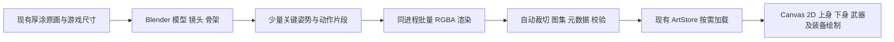

# 《荒原回响》巡线者 3D 制作、2D 运行的动作样板实施计划

日期：2026-09-28。状态：实施设计，尚未建模、制作动作或接入游戏。依据：[人物动画路线复审](./character-animation-pipeline-evaluation-2026-09-28.md)与玩家否决的 v1/v2 跑步样板。只做巡线者默认服饰一名角色；静态人物继续为当前可玩版本。原画身份、Canvas 2D、枪械内容 ID、碰撞、存档和 60 Hz 逻辑均保留。

## 0. 已核实的工具与项目基线

| 项目 | 当前事实 | 计划含义 |
|---|---|---|
| Blender | 用户提供的 D 盘便携版 `blender.exe`，Blender **5.2.2 LTS**；后台 Python 可运行 | 可使用 Blender 原生建模、骨架、动作和脚本导出；项目脚本使用可配置的 `WASTELAND_BLENDER_BIN`，不提交个人绝对路径 |
| 无界面渲染 | 已用 Eevee、正交镜头、透明胶片、PNG RGBA 生成 `output/blender-probe/frame_0001.png`；128×128、alpha 0–255 | 工具链在本机可执行；这只是技术探针，不代表人物模型或画风已经通过 |
| 启动成本 | 默认场景首次后台渲染约 15 秒；输出正常，进程退出码 0 | 同一次 Blender 进程批量导出多个帧；灰模期降低采样，最终画质由实际画面对比决定 |
| 当前游戏 | 战斗人物高度约 76 世界单位，固定视野参考 1280×720；1440p 时世界绘制最多放大到 2 倍 | 用 76px 和 152px 两种成品显示尺度同时检查；导出尺寸不能只看源图清晰度 |
| 素材与发布 | 当前 51 件运行 WebP 约 7.47 MB；`ArtStore` 按需加载并在回菜单释放战斗图 | 样板按当前英雄与地图加载；不在启动菜单预加载全部动作，不发布未完成预览 |
| 版本 | 分支 `feat/illustrated-overhaul`；两版失败动作已 revert，静态画面通过 `npm.cmd run check` | 另建 `codex/ranger-3d-motion-pilot` 隔离样板；审美关口不过，不改活动战斗渲染 |

所有画风参考使用已有 `art/generated/v1.5/source/ranger-base-v1-source.png` 与现有战斗截图。两次失败图集可从提交 `ca0ad11`、`9bc2b8d` 取回作反面比对，不能直接再切成正式肢体。

## 1. 最终结构：可编辑 3D 源，轻量 2D 运行



游戏不运行 Blender 或 3D 模型。玩家机器只收到压缩后的 2D 图集和少量帧数据。建模源负责透视、遮挡、关节体积与可复用服饰；动作先在源中经过人工关键姿势审查，再导出图片。这个分工借鉴[《死亡细胞》美术复盘](https://www.gamedeveloper.com/production/art-design-deep-dive-using-a-3d-pipeline-for-2d-animation-in-i-dead-cells-i-)的“骨架动作先成立、再导出 2D 帧”，具体俯视射击状态由本游戏自行设计。

### 美术源与固定镜头

- 模型先只做巡线者默认服饰的**灰模**。尺寸与比例以旧静态像的面罩、宽肩、外套下摆和双靴剪影为准；模型必须有可见的侧面和背面体积。
- 用正交或弱透视相机，先输出三组镜头角度静止样张，在现有地图上以 76px 比较正面、背面和侧面。镜头、光源、角色高度、脚底世界锚点随后锁定；全部动作从同一镜头批量导出。
- 骨架至少包含 `root/pelvis/spine/head`、左右 `shoulder/elbow/wrist`、左右 `hip/knee/ankle/toe`。右手枪柄、左手前握位以独立控制器确定，枪械本体仍使用当前内容 ID。
- 换装约定：头盔挂头骨架，胸甲挂躯干，腿挂分别挂大腿，护胫挂小腿，靴子挂足部。后续服饰改变模型网格/材质，不复制整套动作；装备先在源模型上验证遮挡和外套穿帮。
- 灰模过关后，按原画绘制布料、锈色皮革、面罩、补丁与手绘边缘。可用低面数模型加手绘贴图、受控阴影与轮廓，必要时对关键帧做少量 2D 修画。禁止把原始正面 PNG 直接贴在平面上冒充三维人物。

### 动作源：先姿势，后补帧

| 片段 | 最先制作的姿势/检查 | 说明 |
|---|---|---|
| `idle` | 有重量的站姿、轻微呼吸、双脚稳定 | 首帧必须与现有静态人物身份一致 |
| `run_forward` | 左右落脚、下沉、经过、蹬地/腾空四类关键姿势 | 脚底接触不能由正弦函数猜出；骨盆高低和肩髋反向摆动明确 |
| `run_back` | 退步、脚掌重新着地、上身仍可瞄准敌人 | 与向前跑分开；避免向上移动时正面人物“月球漫步” |
| `strafe_left/right` | 横移跨步、骨盆朝向和持枪上身扭转 | 移动方向与瞄准方向独立，是本游戏必验场景 |
| `stop/turn` | 收脚、转身、重心停止 | 撞障碍不位移时不继续空跑；转向不瞬间切错脚 |
| `aim_sidearm` | 枪柄手、支撑手与肩肘组成可信姿势 | 初样板仅起始手枪；长枪/重武器以后按姿势家族扩展 |

动画师先看无纹理灰模的接触姿势、剪影和节奏，只有这些成立才加过渡帧。IK 用来固定已设计好的落脚与握枪目标，**不能替代关键姿势**。动作片段保持 in-place；玩家世界坐标、射程和碰撞仍由现有游戏模型决定。

## 2. Blender 到游戏的文件与数据接口

建议目录（灰模和最终源都按版本保存，临时帧进入被 Git 忽略的 `output/`）：

```text
art/animation/ranger/
  ranger-motion-v1.blend       # 可编辑模型、骨架、相机、动作和材质
  README.md                    # 相机角度、比例、参考图、动作清单
scripts/blender/
  export-ranger-motion.py      # 单进程批量帧、透明度和锚点导出
scripts/
  pack-ranger-motion.py        # 复用现有 Pillow：裁切、图集、SHA、尺寸预算及运行元数据模块
output/animation/ranger/      # 可重建的灰模片段、临时 PNG、对比视频
web/assets/actors/            # 仅验收后的活动 WebP 图集
src/render/animation/         # 自动生成的帧元数据 JS、播放、状态选择与静态回退
```

本机已从用户提供的 Blender 可执行文件成功运行后台渲染；正式脚本先读取 `WASTELAND_BLENDER_BIN`，再尝试 PATH，报错时展示如何设置路径。项目不在 Git 中硬编码个人安装位置，也不安装第三方 Blender 插件。`.blend` 的实际大小测量后决定普通 Git 或 Git LFS，避免随意提交数百 MB 的临时帧。

导出器需要在**一个 Blender 进程**中打开 `.blend`，逐动作、朝向、帧设置姿势和同一个相机，输出 RGBA PNG；同时把 `root/feet/rightGrip/leftSupport` 等控制器投影成相对于脚底锚点的像素坐标。打包器核对帧数量、透明通道、尺寸、超出画框的肢体、总字节和固定 ID，产生 WebP、留作溯源的 JSON 和供当前自定义 CommonJS bundle 引入的 JS 元数据模块。现有桌面打包脚本只自动带入活动图片，因此元数据进入代码 bundle，避免浏览器版和 Windows 包读到不同文件。失败时中止接入，不用缺帧的图集冒充通过。

元数据契约示意：

```json
{
  "actorId": "ranger",
  "skinId": "wanderer",
  "viewVersion": 1,
  "layers": ["lower", "upper"],
  "clips": {
    "run_forward": {
      "direction": "south",
      "frames": [
        { "rect": [0, 0, 160, 160], "durationMs": 83, "root": [80, 140], "rightGrip": [91, 76], "leftSupport": [104, 74] }
      ]
    }
  }
}
```

这里的坐标和帧时长**仅示范字段**，不是已定稿数值。最终裁切框与帧数以 76px 画面通过后的实际导出为准。上、下身若分层，必须从同一 `.blend`、相机、姿势和根部锚点输出；外套盖住腰缝。只按少量朝向和武器姿势家族组合，避免把九套服饰、八方向、七把枪全部烘焙成完整人物组合。

## 3. 游戏代码接入边界

- 在模型之外增加只负责视觉的 `AnimationState`：输入本局引用、玩家真实位移、朝向与瞄准向量、武器姿势家族；输出 `clip/facing/phase/frame`。脚步相位根据实际位移和该动作导出的步长推进；停步、暂停、重新开局、异常位移分别有确定规则。动画状态不写进存档。
- `src/render/illustrated-actors.js` 仅在 `ranger/wanderer` 和新图集准备好时使用动画。否则继续画当前静态 PNG；背包人物与其他英雄保持原样。`ArtStore` 在部署时异步准备所选角色的图集，回菜单释放，避免主菜单冷启动受影响。
- 运行时先试“下身随移动、上身随瞄准、枪械依导出握点”的 2D 组合。上、下身动作来源必须统一；如果实际画面出现腰部断裂或严重纸片感，应先回 Blender 修源和输出层，再决定改为少量关键组合整身帧。不要在 Canvas 中靠额外正弦和自动 IK 修画错的帧。
- 现有 `GameModel`、敌人 AI、碰撞地图和内容注册表均无需改写。第一样板不变更武器数值、升级、装备属性或存档 schema；装备外观只有在模型插槽与导出层通过样板后才接入。

## 4. 实施顺序与验收门槛

| 阶段 | 交付物 | 必须通过才继续的检查 |
|---|---|---|
| A · P0 镜头与比例 | 三角度静止灰模叠入现有战斗地图，76px 和 152px 对照图 | 面罩、肩宽、脚底和地图透视协调；玩家选定一个镜头 |
| B · P0 灰模动作 | 巡线者无枪 `idle/run_forward/run_back/strafe` 短片和关键姿势接触表 | 玩家看得到落脚、重心与方向，无滑步、无纸偶转杆；失败只修姿势 |
| C · P0 手枪上身 | 起始手枪右手握柄、左手支撑、移动中瞄准的灰模片段 | 双手与枪不漂浮；前进/后退/横移与瞄准组合成立 |
| D · P0 画风 | 固定光源手绘材质、正侧背角色样张 | 与现有菜单、敌人、地图同属一个画风；76px 能认出巡线者 |
| E · P0 导出器 | `.blend`、批量 RGBA 帧、图集、锚点 JSON、来源与哈希 | 干净重建两次帧数、锚点和像素差异在容差内；批准产物记录哈希；缺图有静态回退；源图不进入安装包 |
| F · P0 游戏样板 | 仅巡线者默认服饰可试玩，其他内容仍静态 | 960×540、720p、1080p、1440p；键鼠与手柄；与静态版并排真人确认 |
| G · P1 扩展决定 | 用户视觉意见、实际制作时间、包体与 WebView2 内存/帧率记录 | 玩家认可后才排九套服饰、护具和敌人；不提前批量生产 |

性能门槛沿用项目现有目标：1080p 常规约 60 FPS、1% low 目标不低于 50 FPS、最低环境持续不低于 30 FPS。先测灰模短片的审美，再测游戏里的 80/120 敌人样本、真实 WebView2 8 分钟以上局和切页内存；Edge headless 短样本仅作辅助。活动素材工作预算仍参考 12 MB 上限，当前约 7.47 MB；样板实际大小超预算时，先核对分辨率、裁切与内存，再决定是否提高预算，不预先牺牲画风。

### 工作量和主要风险

| 工作 | 预期工作量 | 当前不确定性 |
|---|---|---|
| 固定镜头与灰模比例 | 中 | 地图是俯视世界，原画人物较偏正面；必须以叠图确认相机角度 |
| 角色网格、骨架和关键跑步姿势 | 高 | 工具已就绪，但自然动作需要真正的造型和关键帧审查，程序自动化不能代替 |
| 厚涂材质、面罩身份和衣摆 | 高 | 3D 输出可能偏塑料或失去原画笔触；失败时应停在一名角色而非继续扩图 |
| 批量导出、图集与 Canvas 接入 | 中 | 现有 Pillow、素材清单和 ArtStore 可复用；主要是层间锚点和少量动作状态 |
| 九种服饰、护具和八类敌人扩展 | 极高 | 只在巡线者动作和画风同时通过后重新估算；不能按“换贴图即完成”估工 |

这些是相对工作量，不是日期承诺。当前可先用程序化灰模验证镜头和导出，真正与现有厚涂插画同等级的角色网格、材质和姿势仍需逐项视觉验收。

## 5. Git 与失败回退

- 每个可评审关口单独提交：镜头、灰模、关键姿势、材质、导出器、运行时接入。模型源、可重建脚本、元数据和截图结论互相对应；`output/` 临时帧和本地试玩包不加入源码 Git。
- 新尝试先在独立 `codex/ranger-3d-motion-pilot` 分支或合适工作区，不改变当前认可的静态角色。只有用户看过阶段 B/C 的实际视频并认可，才把活动渲染切向新图集；未通过直接停在源模型修正，分支可回退。
- 不发布 alpha 标签、不合并 `main`、不宣称全部人物动画完成。当前两次失败动作和恢复静态人物的 revert 提交继续作为验收依据。
