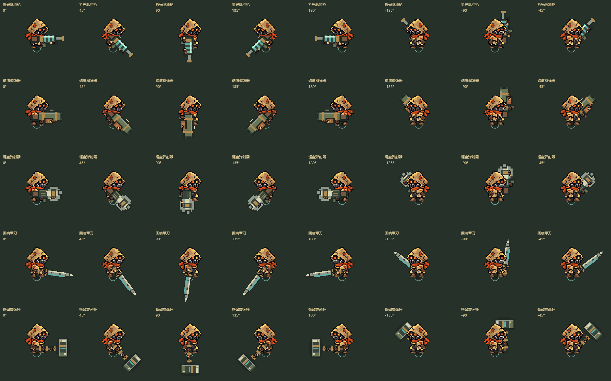
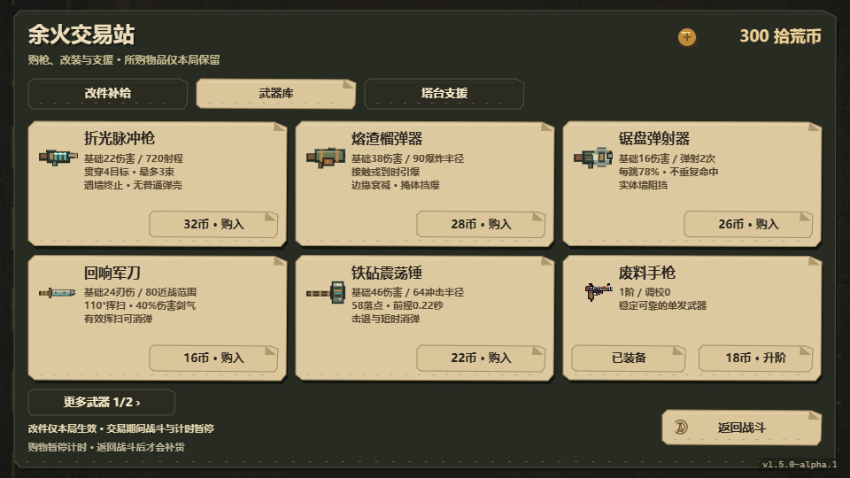

# 武器扩展、抛壳与近战设计

日期：2026-10-29。基线：`6d8b490`。分支：`codex/weapon-variety-melee`。沿用三图连续生存、自动锁敌与射击、交易站购枪、单把当前主武器和塔台；不新增多枪并持、能量经济或强制换弹。

## 调研与取舍

| 核对来源 | 确认内容 | 本项目采用方式 |
|---|---|---|
| [Brotato武器总表](https://brotato.wiki.spellsandguns.com/Weapons) | 近战有挥扫／突刺并可命中路径中多个敌人；远程默认单体，穿透／弹射扩展多目标；四阶与同类合并服务构筑 | 采用攻击结构区分用途，继续按本局升阶；不引入六槽并持 |
| [Brotato射程](https://brotato.wiki.spellsandguns.com/Range) | 近战射程属性按一半作用，挥扫增大覆盖；范围还影响原作动作时间 | 近战设置独立有限范围成长，显示与判定共用参数。原作单位不等于本项目世界像素，不直接照搬175／200等数字 |
| [Brotato Laser Gun](https://brotato.wiki.spellsandguns.com/Laser_Gun) | 高单发、较慢、带有限穿透的远程武器；原作远程说明使用投射物 | 不把所有名字带激光的枪当成瞬时射线，保留现有线圈炮飞行贯穿弹，另做明确的脉冲射线 |
| [Brotato Plasma Sledge](https://brotato.wiki.spellsandguns.com/Plasma_Sledgehammer) | 挥扫近战，可触发爆炸，兼有近战与元素成长 | 锤子使用有前摇、范围有限的落点冲击；近战与爆炸效果可以组合，但本轮不复制原作具体概率 |
| [Brotato Thunder Sword](https://brotato.wiki.spellsandguns.com/Thunder_Sword) | 挥扫命中后会衍生额外投射物 | 军刀同时提供短程刃伤与有限距离剑气，衍生伤害有明确倍率，不把视觉拖影全部当额外命中 |
| [Soul Knight Laser Shotgun](https://soul-knight.fandom.com/wiki/Laser_Shotgun) | 维基Usage明确描述四条扇形贯穿激光；增宽与增加光束数量是不同效果 | 激光有亮芯、外缘、短寿命和墙体终点；分流可增加少量射线，不用矩形子弹改色冒充射线 |
| [Soul Knight Stone Hammer](https://soul-knight.fandom.com/wiki/Stone_Hammer) | 冲击波伤敌并消除敌弹；暴击眩晕；攻击间隔长，持攻影响移速 | 借鉴砸地、扩散冲击和短时间消弹。保留玩家移动自由，避免自动攻击持续减速；不提供全程无敌，不照抄眩晕链 |

来源是公开社区资料，Brotato总表标注Patch 1.1.6.3，其他页面修订时间不同；只核对机制，不声称其参数代表所有平台当前版本。部分Fandom页面由默认提取器读取失败，Laser Shotgun／Stone Hammer通过另一公开提取器取得正文；Ion Laser／Caliburn未读到完整正文，不据此宣称其精确内部实现。未复制竞品素材、代码、命名或动画帧。

## 本轮制作范围

以下均为项目初始设计数值，需要真人试玩调整；1世界单位对应当前逻辑坐标，不是竞品单位。

| 武器 | 战斗职责 | 核心参数与判定 | 动作／特效／声音 |
|---|---|---|---|
| 折光脉冲枪 | 中远程直线穿透，利用敌群排列 | 瞬时射线，基础22伤害、0.60秒间隔、720距离，有限穿透；墙体截断；分流最多3束 | 青白亮芯、克制外缘、终点火星、短电磁脉冲；不抛普通弹壳 |
| 熔渣榴弹器 | 慢速范围清群，预判密集落点 | 基础38伤害、1.05秒间隔、360弹速；接触／寿命结束爆炸，90半径、有边缘衰减；墙体隔爆，不自伤 | 有尾焰的实体榴弹、扩张爆炸圈与碎屑；发射低频冲击、单独爆炸声，较重金属壳 |
| 锯盘弹射器 | 在分散目标间转移伤害 | 基础16伤害、0.48秒间隔、430弹速；最多2次转向弹射，每跳伤害保留78%；不重复命中旧目标，墙体阻挡 | 旋转锯齿实体、很短的轨迹和金属命中；无假弹壳 |
| 回响军刀 | 近距扇形清群，并用剑气补中距离 | 基础24刃伤、0.62秒间隔；80半径／110度挥扫；0.09秒前摇＋0.14秒有效段；剑气为40%伤害，有限距离与穿透 | 武器及独立手／袖口一起挥动、弧形刃迹、前进剑气；短风切与独立金属命中。只有有效挥扫段可挡对应范围敌弹 |
| 铁砧震荡锤 | 较慢的近距爆发／击退，创造脱身空隙 | 基础46伤害、1.25秒间隔；0.22秒前摇，前方58落点／64半径冲击；扩散伤害同敌一次，墙体阻挡 | 举锤、落锤、环形尘浪／地裂与受控镜头冲击；挥动声与落地重击分开；冲击仅在有效段消除范围内敌弹 |

从7把枪扩为10把远程武器＋2把近战。新增物品先在局内交易站直接可买；局外购买提供起始武器选择。延续现有人物美术、独立枪体／手套／袖口结构。新轮廓使用项目原生像素绘制描述，与现有装备图标共用绘制体系，不新增大角色图集或运行时依赖。

## 抛壳改造

手枪用小黄铜壳，冲锋枪用更小且快速的壳，步枪／卡宾枪用细长壳，霰弹枪用红色塑料壳＋黄铜底，新榴弹器用较重金属壳。分别设置初速度、上抛高度、旋转、落地反弹与短暂留地后淡出。左轮仍不逐发自动抛壳；能源与锯盘武器没有普通弹壳。延迟抛壳跟随对局时间，暂停冻结，换局清空。

## 实现顺序与验收

1. 把射线、爆炸、弹射、近战的参数与几何规则集中，保留已有七枪ID及数值。判定与主要特效共用实际起终点／角度／半径。
2. 接入五种攻击、对象池字段与有界短期效果，验证薄墙、贴身、多目标、同敌去重、寿命末段、首领抗性和消弹有效窗口。
3. 制作五种原生像素轮廓，复用独立手与袖口；近战只驱动持物层，移动步相不被重置，8方向检查遮脸和剪影。
4. 接入专用声音、分枪抛壳、弹道与命中；低闪光仍保留轮廓、落点和攻击范围，敌弹在非关键特效之后绘制。
5. 接入局内武器库、局外购买与卡牌适配；近战不出现纯弹丸类无效升级，提供范围成长，切换取消未完成挥击但不改变已发出投射物。
6. 自动回归、实际浏览器逐枪录屏／声音、三个地图样本和性能压力，通过后输出独立Windows内部包并保存开发分支；不发布新Release或提前打标签。

低配约束：沿用现有实体池和60Hz逻辑；射线、冲击、挥击有固定数量与寿命；弹壳使用有限槽，生成纹理按武器缓存，禁止随帧创建图片／音频资源。

## 本轮实现与验收

实现范围已完成，已通过以下自动与画面检查；Windows构建记录另见[打包证据](qa/weapon-expansion-build-2026-10-29.json)。本轮使用独立内部包，不创建公开Release或版本标签。

- `npm.cmd run check`通过，331项测试、0失败；包含旧内容／存档回归、三图连续生存矩阵和十分钟压力模拟。新增22项专项检查覆盖激光、爆炸、弹射、近战时序、消弹、油桶交互、池字段清理、弹壳反弹／暂停等。
- 激光拆分为握点至枪口与真正射线两段，按真实路径处理贴身、掩体与目标，不让分流射线偏离可见轨迹。激光与近战可以引爆地图油桶，油桶爆炸也遵循墙体遮挡。刃迹、爆炸圈与锤击尘浪按掩体截断。
- [真实浏览器验证](qa/weapon-expansion-browser-2026-10-29.json)：五新武器、40个方向姿态、十二件武器采样实际播放、四种分辨率交易页和真实购买流程通过，无页面错误。已人工查看方向板、540p交易页及低闪光攻击截图。修复过方向板被完整画面覆盖、窗口缩放后截图黑屏的问题，记录不是仅靠“零错误”判定。
- [性能验证](qa/weapon-expansion-performance-2026-10-29.json)：七场景通过原有1%低帧不低于30FPS门槛；包括720p80敌、1080p120敌、104敌＋四塔、六发榴弹密集爆炸、三束激光、剑气与重锤。新武器场景使用高血量敌人，攻击确实持续发生。当前机器Edge无界面短测的p95约7.0～7.1ms，不能代表低配或原生窗口长局。
- [三图与近战长模拟](qa/weapon-expansion-simulation-2026-10-29.json)：五武器×三图各180秒，军刀／锤各追加900秒，共17场、模拟75分钟，未突破实体上限。使用高生命、脚本走位与自动升级，不作为正常玩家难度或胜率证据。近战在不同地图的输出差异明显，应先本人试玩，不据该夹具直接调强。
- 活动图片仍为59张，五新武器按需创建小像素画布并缓存；活动音频21个共650,600 bytes，新9个共108,000 bytes；打包运行树85个文件、7,672,541 bytes。无新增运行时npm依赖，短声音仅解码一次，弹壳32槽、攻击效果32槽沿用有界结构。
- [音频来源](../art/audio/arsenal-v2/README.md)、[素材台账](assets-ledger.csv)与覆盖审计已更新；旧七枪源素材导入器只处理其拥有的原始素材，避免新武器导致旧制作流程寻找不存在的PNG。

## 试玩入口与下一步

Windows：`output/weapon-expansion-2026-10-29/windows/WastelandEcho-v1.5.0-alpha.1-win-x64.exe`。本轮沿用内部版本号，文件夹区分批次，不能拿上一批同版本号exe替代本轮包。

快速比较：[武器审阅与带声音演示](../output/weapon-expansion-2026-10-29/review.html)、[独立可操作试射台](../output/weapon-expansion-2026-10-29/workshop.html)。试射台不写正式存档，固定靶停止自主移动但保留真实击退；可切换十二件武器、掩体、自动攻击、敌人移动及降低特效。

1. 先在试射台比较五件新武器，确认转向、武器与手的位置、挥击节奏、范围及听感。
2. 在完整游戏的回声旧城进行正常生命试玩，返回交易站购买新武器，记录第一次购入时间、死亡原因、军刀／锤能否安全接敌；先取得记录再调整数值。
3. 用耳机和扬声器复听重复发射；确认激光不刺耳、榴弹与锤击不会盖住危险提示。
4. 实体手柄全流程、真实Windows窗口30～60分钟与明确低配电脑验证仍待完成，不用自动按键或高血模拟代替。

